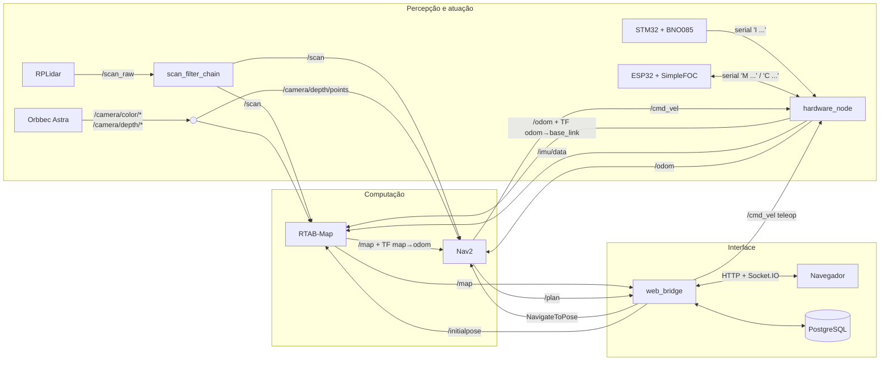
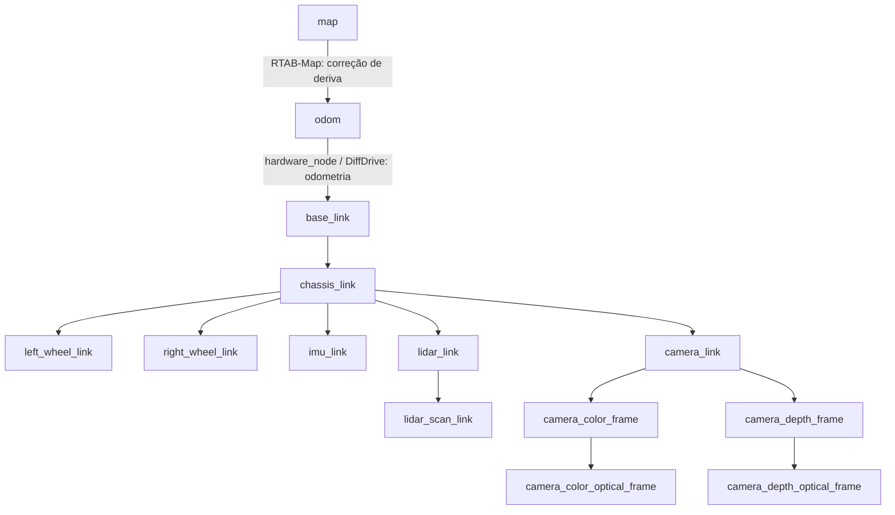
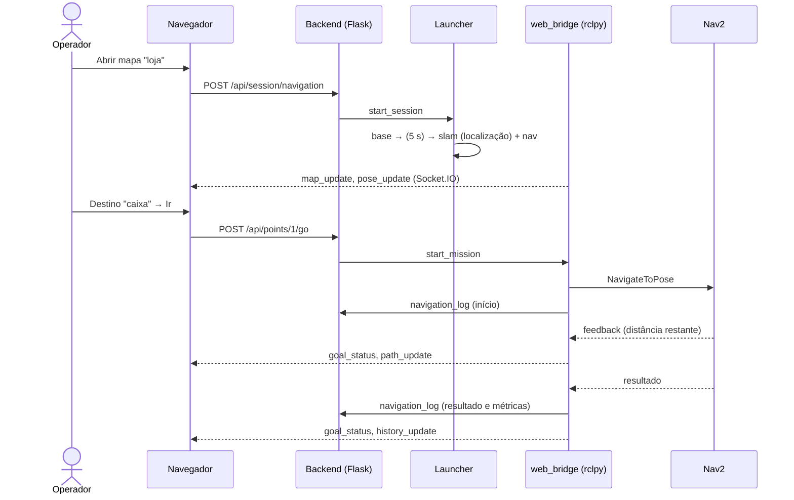
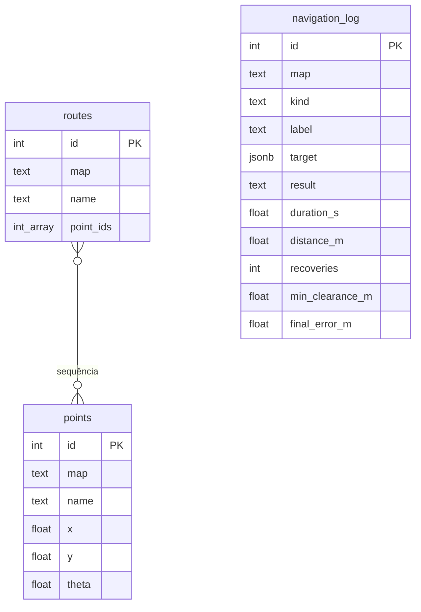

# Arquitetura do software

## 1. Camadas

| Camada | Robô físico | Simulação |
|---|---|---|
| Percepção | RPLidar, Orbbec Astra, IMU BNO085 (STM32F401) | sensores do Gazebo (`gpu_lidar`, `rgbd_camera`, `imu`) |
| Atuação | ESP32 + SimpleFOC, motores BLDC | plugin `DiffDrive` do Gazebo |
| Driver | `hardware/hardware_node` | ponte `ros_gz_bridge` + `cmd_vel_relay` |
| Computação | RTAB-Map + Nav2 (pacote `navigation`) | idem, com `use_sim_time` |
| Interface | backend Flask/rclpy + frontend React/TypeScript | idem, com `ROBOT_SIM=1` |

As duas colunas convergem para os mesmos tópicos (`/scan`, `/odom`,
`/imu/data`, `/camera/*`, `/cmd_vel`). Por isso a computação e a interface são
idênticas nos dois casos.

## 2. Fluxo de dados entre os módulos

Cadeia de velocidade dentro do Nav2:
`controller_server → /cmd_vel_nav → velocity_smoother → /cmd_vel`.

## 3. Árvore de transformações (TF)

- `odom → base_link` é contínua, sem saltos: a velocidade linear vem dos
  encoders e a angular do giroscópio.
- `map → odom` é publicada pelo RTAB-Map e absorve as correções do
  ICP/fechamento de loop. O robô "salta" no mapa, nunca na odometria.

## 4. Mapeamento e localização (RTAB-Map)

| | Mapeamento | Localização |
|---|---|---|
| Memória | incremental (grava o `.db`) | somente leitura |
| Registro | ICP sobre o LiDAR | visual (com câmera) ou ICP |
| Fechamento de loop | aparência visual (GFTT/ORB, bag-of-words) | idem, para relocalizar |
| Grid 2D para o Nav2 | só LiDAR (`Grid/Sensor=0`) | carregado do `.db` |

Arquivos: `navigation/config/rtabmap_common.yaml` (comum) mais
`rtabmap_mapping.yaml` ou `rtabmap_localization.yaml`.

## 5. Gestão de rotas (Nav2)

- **Planejador global**: NavFn (A*) sobre o costmap global, que é o mapa do
  RTAB-Map somado aos obstáculos atuais. A behavior tree padrão replaneja a
  1 Hz.
- **Controlador local**: Regulated Pure Pursuit com detecção de colisão à
  frente.
- **Obstáculos dinâmicos**: camada de obstáculos com o LiDAR (marca e limpa) e
  com a nuvem da câmera (objetos acima/abaixo do plano do laser).
- **Recuperações**: girar, recuar e esperar, quando o caminho fica bloqueado.
- **Rotas da interface**: o backend executa cada destino da rota como um
  `NavigateToPose` separado, o que permite medir cada trecho.

## 6. Interface web

O backend sobe a pilha ROS como três processos (`base`, `slam`, `nav`). Ao
parar, envia SIGINT a cada um, e o RTAB-Map grava o mapa antes de sair.

### Banco de dados

## 7. Protocolo serial com os microcontroladores

Texto ASCII, uma mensagem por linha, 115200 bps.

| Direção | Mensagem | Significado |
|---|---|---|
| host → ESP32 | `C <vel_esq> <vel_dir>` | velocidade-alvo das rodas (rad/s) |
| ESP32 → host | `M <vel_esq> <vel_dir> <pos_esq> <pos_dir> R` | telemetria a 50 Hz |
| STM32 → host | `I <yaw> <pitch> <roll> <gx> <gy> <gz> <ax> <ay> <az>` | IMU a 50 Hz (rad, rad/s, m/s²) |
| qualquer → host | `# <texto>` | log |

Segurança em três níveis:

1. o firmware zera a velocidade sem comandos por 500 ms;
2. o `hardware_node` para sem `/cmd_vel` por 0,5 s;
3. o `hardware_node` recusa comandos se a telemetria dos motores parar.
