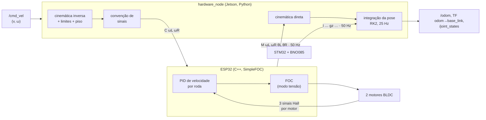

# Controle da base: firmware, driver e odometria

Este documento cobre a parte mais baixa da pilha: como um comando de
velocidade `(v, ω)` vira rotação das rodas, e como a rotação das rodas e o
giroscópio viram a odometria que alimenta o SLAM e a navegação.

---

## 1. Firmware dos motores (ESP32)

Arquivo: `hardware/firmware/esp32_motor_controller/esp32_motor_controller.ino`.

**Motores.** Dois BLDC de hoverboard (15 pares de polos, 24 V), cada um com
ponte trifásica comandada por 3 PWM e 3 sensores Hall lidos por interrupção.

**Controle.** A biblioteca **SimpleFOC** faz o controle orientado a campo
(FOC): a cada iteração lê o ângulo elétrico pelos Hall e aplica, nas três
fases, as tensões que produzem torque máximo para aquele ângulo. Por cima do
FOC roda uma malha de **velocidade** em malha fechada por roda:

| Parâmetro | Valor | Papel |
|---|---|---|
| `PID_velocity.P` / `.I` / `.D` | 0,9 / 2,1 / 0 | PI de velocidade: o integrador elimina o erro em regime (carga, atrito) |
| `output_ramp` | 5000 V/s | limita a variação da tensão comandada |
| `LPF_velocity.Tf` | 0,01 s | filtro passa-baixa na velocidade medida (os Hall dão resolução angular baixa) |
| `voltage_limit` | 24 V | tensão máxima nas fases |

**Dois núcleos.** O `loop()` (núcleo 1) roda só o `loopFOC()` e o `move()` dos
dois motores, o mais rápido possível. A comunicação roda numa tarefa FreeRTOS
separada (núcleo 0) com período fixo de 20 ms: lê os comandos `C`, envia a
telemetria `M` e aplica o **watchdog** (sem comando por 500 ms, a velocidade-alvo
vai a zero). Assim, a serial nunca atrasa o laço de controle.

**Partida.** A calibração do FOC (alinhamento dos sensores) leva alguns
segundos; durante ela o firmware envia `# calibrando motores...` a cada
segundo, para o driver saber que a placa está viva.

## 2. Firmware da IMU (STM32)

Arquivo: `hardware/firmware/stm32_imu/stm32_imu.ino`. Lê a **BNO085** por I2C
(endereço 0x4A) e envia orientação (yaw, pitch, roll), velocidade angular e
aceleração linear a 50 Hz pela USB CDC. A orientação vem do *game rotation
vector* da BNO085, a fusão interna do acelerômetro com o giroscópio **sem o
magnetômetro**: perto das estruturas metálicas e dos motores de uma loja, o
campo magnético é distorcido e pioraria o yaw. Se os dados pararem por 500 ms,
o firmware reinicializa o sensor.

## 3. Protocolo serial

Texto ASCII, uma mensagem por linha, 115200 bps (tabela completa em
[arquitetura.md §7](arquitetura.md#7-protocolo-serial-com-os-microcontroladores)).
O parsing e a formatação estão em funções puras de
`hardware/hardware/protocol.py`, testadas em `tests/test_protocol.py`.

Texto em vez de binário foi uma escolha consciente
([decisoes-arquitetura.md](decisoes-arquitetura.md)): dá para depurar abrindo a
porta num terminal, e 50 mensagens de ~40 bytes por segundo ocupam menos de
20% da banda a 115200 bps.

**Enlace** (`hardware/hardware/serial_link.py`): uma thread por porta lê
linhas e as entrega ao driver. Se a porta cai (cabo, reset da placa), a thread
tenta reabrir a cada segundo, sem derrubar o nó. Ao abrir, mantém DTR/RTS
baixos para não resetar o ESP32 (as placas DevKit entram no *bootloader* por
esses sinais), exceto em portas `ttyACM` (STM32), que só transmitem com DTR
alto.

## 4. Driver ROS: `hardware_node`

Arquivo: `hardware/hardware/hardware_node.py`, parâmetros em
`bringup/config/hardware.yaml`.

### 4.1 Cinemática diferencial

Com raio da roda $r = 0{,}0825$ m e bitola $L = 0{,}310$ m:

**Inversa** (comando → rodas):

$$\omega_L = \frac{v - \omega L/2}{r} \qquad \omega_R = \frac{v + \omega L/2}{r}$$

**Direta** (rodas → velocidade do robô):

$$v = \frac{r(\omega_L + \omega_R)}{2} \qquad \omega = \frac{r(\omega_R - \omega_L)}{L}$$

### 4.2 Do `/cmd_vel` ao comando `C`

1. Valor não finito (NaN/inf) → para.
2. Telemetria dos motores há mais de 1 s (`serial_timeout`) → recusa e para.
3. Satura em 1,0 m/s e 1,5 rad/s.
4. Cinemática inversa.
5. **Piso de velocidade** (`apply_wheel_floor`): abaixo de 0,15 rad/s a roda
   fica parada (zona morta); entre 0,15 e 1,5 rad/s sobe para 1,5 rad/s,
   preservando o sentido. Motivo: o BLDC com Hall, abaixo de ~1,5 rad/s,
   **vibra em vez de girar**, porque a resolução dos Hall (6 estados por
   ciclo elétrico) não sustenta o controle a baixa velocidade. Esse piso
   (≈ 0,12 m/s em linha reta) é o que define as velocidades mínimas
   configuradas no Nav2 e no seguidor de parede.
6. **Convenção de sinais** (`WheelMapping`): a montagem física (motor
   espelhado, fios) exige inverter sinais e trocar esquerda/direita; comando e
   realimentação têm ajustes independentes (`invert_command`, `swap_command`,
   `invert_feedback`, `swap_feedback`).
7. Envia `C ωL ωR`.

Um timer a 10 Hz implementa o **watchdog** do driver: sem `/cmd_vel` por
0,5 s, envia `C 0 0`.

### 4.3 Odometria

A cada 25 Hz o driver integra a pose:

- **velocidade linear** $v$: das rodas (cinemática direta);
- **velocidade angular** $\omega$: do **giroscópio** da IMU, quando ela está
  saudável; senão, das rodas.

Por que o giroscópio: em curvas e giros no lugar, as rodas **escorregam**, e a
diferença de velocidade entre elas superestima ou subestima a rotação. O erro de
ângulo é o pior erro de odometria, porque um grau errado vira metros de erro de
posição depois de uma reta longa. O giroscópio mede a rotação do corpo
diretamente, sem depender do contato com o chão.

A integração usa o **método do ponto médio** (Runge-Kutta de 2ª ordem):

$$\theta_m = \theta_k + \tfrac{\omega\,\Delta t}{2} \qquad
x_{k+1} = x_k + v\cos\theta_m\,\Delta t \qquad
y_{k+1} = y_k + v\sin\theta_m\,\Delta t \qquad
\theta_{k+1} = \theta_k + \omega\,\Delta t$$

que é exato para arcos de raio constante, ao contrário de Euler, que anda em
linha reta e só depois gira.

Saídas: `/odom` (com covariâncias: pose 0,5, porque acumula deriva; twist
pequena, porque é medida instantânea), TF `odom → base_link`, `/joint_states`
(posição e velocidade das rodas, para o modelo 3D) e `/imu/data`.

### 4.4 Diagnóstico

A 1 Hz o driver publica `/diagnostics` com o estado de cada enlace: `ok`,
`sem dados` (porta aberta, mas sem mensagens) ou `porta fechada`, e há quantos
segundos chegou a última mensagem. A interface mostra esse estado.

## 5. Segurança em camadas

| Camada | Condição | Ação |
|---|---|---|
| Firmware (ESP32) | sem comando `C` por 500 ms | velocidade-alvo = 0 |
| Driver | sem `/cmd_vel` por 0,5 s | envia `C 0 0` |
| Driver | telemetria dos motores parada por 1 s | recusa comandos |
| Driver | comando não finito | envia `C 0 0` |
| Driver | encerramento do nó | envia `C 0 0` e fecha as portas |
| Exploradores | Ctrl+C / SIGTERM | Twist zero e cancela o destino |

Cada camada é independente: se o computador travar, o firmware para; se o
firmware travar, o driver recusa comandos. Todas as decisões do driver são
verificadas em `tests/test_hardware_node.py`.

## 6. Equivalente na simulação

| Robô físico | Simulação (Gazebo) |
|---|---|
| ESP32 + motores | plugin `DiffDrive` (`sim/urdf/robot_sim.urdf.xacro`), aceleração limitada |
| `hardware_node` (odometria) | odometria do `DiffDrive` em `/odom` via `ros_gz_bridge` |
| BNO085 | sensor `imu` do Gazebo em `/imu/data` |
| watchdog do driver | `cmd_vel_relay` (`/cmd_vel → /sim/cmd_vel`), com relógio de parede |

O `DiffDrive` manteria o último comando para sempre; o `cmd_vel_relay` existe
para reproduzir na simulação a mesma proteção do robô real.
