# Diagramas de especificação

Diagramas exigidos e recomendados pela
[direction de IoT](https://github.com/CatolicaSC-Portfolio/The-Portfolio-Playbook/blob/main/directions/portfolio-directions-iot.md),
cada um com a descrição e a fundamentação. Todos estão em Mermaid, renderizados
pelo próprio GitHub, e foram feitos a partir do código deste repositório (os
nomes de tópicos, pinos, frequências e limites são os reais).

| # | Diagrama | Exigência na direction de IoT |
|---|---|---|
| 1 | [Requisitos (SysML, hierárquico)](#1-diagrama-hierárquico-de-requisitos-sysml) | obrigatório |
| 2 | [Arquitetura em camadas IoT](#2-arquitetura-em-camadas-iot) | obrigatório (C4 ou camadas) |
| 3 | [C4 — contexto, containers e componentes](#3-c4-model) | obrigatório (C4 ou camadas) |
| 4 | [Definição de blocos (SysML BDD)](#4-diagrama-de-definição-de-blocos-sysml-bdd) | desejável |
| 5 | [Blocos internos (SysML IBD)](#5-diagrama-de-blocos-internos-sysml-ibd) | desejável |
| 6 | [Malhas de controle](#6-malhas-de-controle) | complementar |
| 7 | [Máquinas de estado da exploração autônoma](#7-máquinas-de-estado-da-exploração-autônoma) | complementar |
| 8 | [Camadas de segurança](#8-camadas-de-segurança) | complementar |

Fluxo de dados entre os nós ROS, árvore de TF, sequência da interface e modelo
de dados estão em [arquitetura.md](arquitetura.md).

---

## 1. Diagrama hierárquico de requisitos (SysML)

O requisito raiz (R0) se desdobra em requisitos funcionais (RF), de desempenho
e de segurança (RNF), e de interface (RI). Cada folha aponta o elemento que a
**satisfaz** (código ou configuração) e o que a **verifica** (teste automatizado
ou ferramenta de métrica).

### 1.1 Visão geral

```mermaid
requirementDiagram

    requirement R0 {
        id: R0
        text: "Robô móvel que mapeia, se localiza e navega com autonomia em ambiente comercial"
        risk: high
        verifymethod: demonstration
    }

    functionalRequirement RF1 {
        id: RF1
        text: "Mapear o ambiente (SLAM)"
        risk: high
        verifymethod: demonstration
    }
    functionalRequirement RF2 {
        id: RF2
        text: "Localizar-se em um mapa salvo"
        risk: high
        verifymethod: analysis
    }
    functionalRequirement RF3 {
        id: RF3
        text: "Planejar e seguir rotas desviando de obstáculos"
        risk: high
        verifymethod: demonstration
    }
    functionalRequirement RF4 {
        id: RF4
        text: "Controlar a base diferencial e estimar a odometria"
        risk: high
        verifymethod: test
    }
    functionalRequirement RF5 {
        id: RF5
        text: "Explorar o ambiente sem operador"
        risk: medium
        verifymethod: test
    }
    functionalRequirement RF6 {
        id: RF6
        text: "Ser operado e acompanhado por interface"
        risk: low
        verifymethod: demonstration
    }
    requirement RNF {
        id: RNF
        text: "Segurança, desempenho e portabilidade"
        risk: high
        verifymethod: test
    }
    interfaceRequirement RI1 {
        id: RI1
        text: "Protocolo serial com os microcontroladores"
        risk: medium
        verifymethod: test
    }

    R0 - contains -> RF1
    R0 - contains -> RF2
    R0 - contains -> RF3
    R0 - contains -> RF4
    R0 - contains -> RF5
    R0 - contains -> RF6
    R0 - contains -> RNF
    R0 - contains -> RI1
```

### 1.2 Mapeamento, localização e rotas (RF1–RF3)

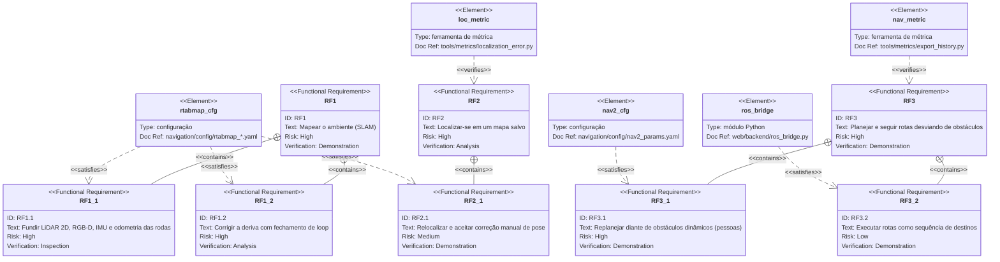

### 1.3 Controle da base, exploração e interface (RF4–RF6, RI1)

```mermaid
requirementDiagram

    functionalRequirement RF4 {
        id: RF4
        text: "Controlar a base diferencial e estimar a odometria"
        risk: high
        verifymethod: test
    }
    functionalRequirement RF4_1 {
        id: RF4.1
        text: "Controle de velocidade das rodas em malha fechada (FOC + Hall)"
        risk: high
        verifymethod: demonstration
    }
    functionalRequirement RF4_2 {
        id: RF4.2
        text: "Cinemática diferencial direta e inversa"
        risk: medium
        verifymethod: test
    }
    functionalRequirement RF4_3 {
        id: RF4.3
        text: "Odometria: linear dos encoders, angular do giroscópio"
        risk: medium
        verifymethod: test
    }
    functionalRequirement RF5 {
        id: RF5
        text: "Explorar o ambiente sem operador"
        risk: medium
        verifymethod: test
    }
    functionalRequirement RF5_1 {
        id: RF5.1
        text: "Estratégias: fronteiras, parede + BFS, desbaste em offsets"
        risk: medium
        verifymethod: test
    }
    functionalRequirement RF5_2 {
        id: RF5.2
        text: "Voltar ao ponto de partida ao terminar"
        risk: low
        verifymethod: test
    }
    functionalRequirement RF6 {
        id: RF6
        text: "Ser operado e acompanhado por interface"
        risk: low
        verifymethod: demonstration
    }
    interfaceRequirement RI1 {
        id: RI1
        text: "Serial ASCII 115200 bps, uma mensagem por linha, telemetria a 50 Hz"
        risk: medium
        verifymethod: test
    }

    element fw_esp32 {
        type: "firmware"
        docref: "hardware/firmware/esp32_motor_controller"
    }
    element protocol {
        type: "módulo Python"
        docref: "hardware/hardware/protocol.py"
    }
    element hw_node {
        type: "nó ROS 2"
        docref: "hardware/hardware/hardware_node.py"
    }
    element explorers {
        type: "nós ROS 2"
        docref: "navigation/scripts/*_explorer.py"
    }
    element webui {
        type: "aplicação web"
        docref: "web/"
    }
    element t_protocol {
        type: "teste"
        docref: "tests/test_protocol.py"
    }
    element t_hw {
        type: "teste"
        docref: "tests/test_hardware_node.py"
    }
    element t_explore {
        type: "teste"
        docref: "tests/test_*_explorer.py"
    }

    RF4 - contains -> RF4_1
    RF4 - contains -> RF4_2
    RF4 - contains -> RF4_3
    RF5 - contains -> RF5_1
    RF5 - contains -> RF5_2
    fw_esp32 - satisfies -> RF4_1
    protocol - satisfies -> RF4_2
    hw_node - satisfies -> RF4_3
    protocol - satisfies -> RI1
    explorers - satisfies -> RF5_1
    explorers - satisfies -> RF5_2
    webui - satisfies -> RF6
    t_protocol - verifies -> RF4_2
    t_protocol - verifies -> RI1
    t_hw - verifies -> RF4_3
    t_explore - verifies -> RF5_1
    t_explore - verifies -> RF5_2
```

### 1.4 Requisitos não funcionais (RNF)

```mermaid
requirementDiagram

    requirement RNF {
        id: RNF
        text: "Segurança, desempenho e portabilidade"
        risk: high
        verifymethod: test
    }
    designConstraint RNF1 {
        id: RNF1
        text: "Parar os motores sem comando: 500 ms no firmware, 0,5 s no driver"
        risk: high
        verifymethod: test
    }
    designConstraint RNF2 {
        id: RNF2
        text: "Recusar comandos sem telemetria dos motores por mais de 1 s"
        risk: high
        verifymethod: test
    }
    performanceRequirement RNF3 {
        id: RNF3
        text: "Velocidade máxima de 1,0 m/s e 1,5 rad/s"
        risk: medium
        verifymethod: test
    }
    performanceRequirement RNF4 {
        id: RNF4
        text: "Telemetria a 50 Hz, odometria a 25 Hz, replanejamento a 1 Hz"
        risk: medium
        verifymethod: inspection
    }
    designConstraint RNF5 {
        id: RNF5
        text: "Mesmo software no robô físico e na simulação (mesmos tópicos)"
        risk: medium
        verifymethod: demonstration
    }
    physicalRequirement RNF6 {
        id: RNF6
        text: "Processamento embarcado em Jetson Orin Nano, motores BLDC a 24 V"
        risk: medium
        verifymethod: inspection
    }

    element hw_yaml {
        type: "configuração"
        docref: "bringup/config/hardware.yaml"
    }
    element sim_pkg {
        type: "pacote ROS 2"
        docref: "sim/"
    }
    element t_hw {
        type: "teste"
        docref: "tests/test_hardware_node.py"
    }

    RNF - contains -> RNF1
    RNF - contains -> RNF2
    RNF - contains -> RNF3
    RNF - contains -> RNF4
    RNF - contains -> RNF5
    RNF - contains -> RNF6
    hw_yaml - satisfies -> RNF1
    hw_yaml - satisfies -> RNF2
    hw_yaml - satisfies -> RNF3
    sim_pkg - satisfies -> RNF5
    t_hw - verifies -> RNF1
    t_hw - verifies -> RNF2
    t_hw - verifies -> RNF3
```

**Fundamentação.** A hierarquia segue o objetivo do projeto, que é de controle
e navegação: RF1–RF4 formam a pilha de autonomia (perceber → estimar →
planejar → atuar), e RF4 é a base de todos os outros, porque mapa e
localização dependem de uma odometria confiável. A interface (RF6) é um
requisito de baixo risco, complementar: tudo o que ela faz também pode ser
feito pela linha de comando (`ros2 launch`, `ros2 action send_goal`). Os
requisitos de segurança (RNF1–RNF3) são verificados por testes automatizados,
porque são os únicos cuja falha causa dano físico.

---

## 2. Arquitetura em camadas IoT

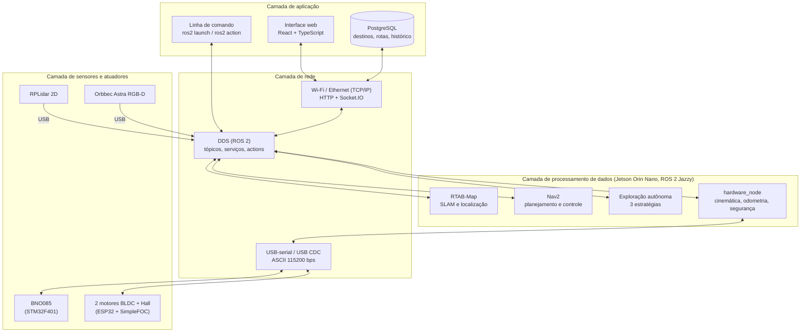

**Descrição das camadas.**

- **Sensores e atuadores.** Dois microcontroladores com firmware próprio
  isolam o tempo real do computador: o ESP32 fecha a malha de velocidade
  dos motores (FOC com sensores Hall) e o STM32 lê a IMU por I2C. O LiDAR e a
  câmera usam os drivers ROS dos fabricantes.
- **Rede.** Três meios, cada um escolhido pelo requisito que atende: serial de
  texto com os microcontroladores (simples, legível no terminal, sem
  dependências no firmware); DDS entre os nós ROS (publicação/assinatura com
  QoS, inclusive entre máquinas); HTTP e WebSocket (Socket.IO) para a
  interface, que precisa de atualização contínua da pose e do mapa sem
  *polling*.
- **Processamento.** Embarcado no Jetson, porque SLAM e controle precisam de
  latência baixa e não podem depender de link externo. É a camada que
  concentra o trabalho do TCC.
- **Aplicação.** Interface web servida pelo próprio robô, mais a linha de
  comando, que dá acesso a todas as funções sem a interface.

---

## 3. C4 Model

### 3.1 Nível 1 — Contexto

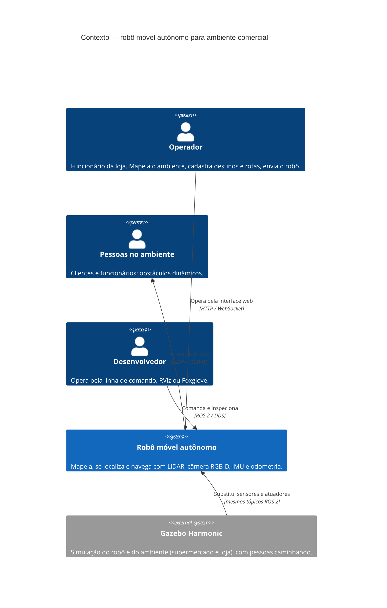

### 3.2 Nível 2 — Containers

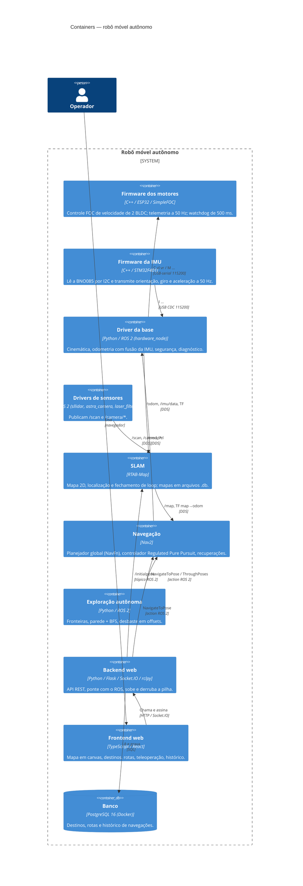

### 3.3 Nível 3 — Componentes do driver da base

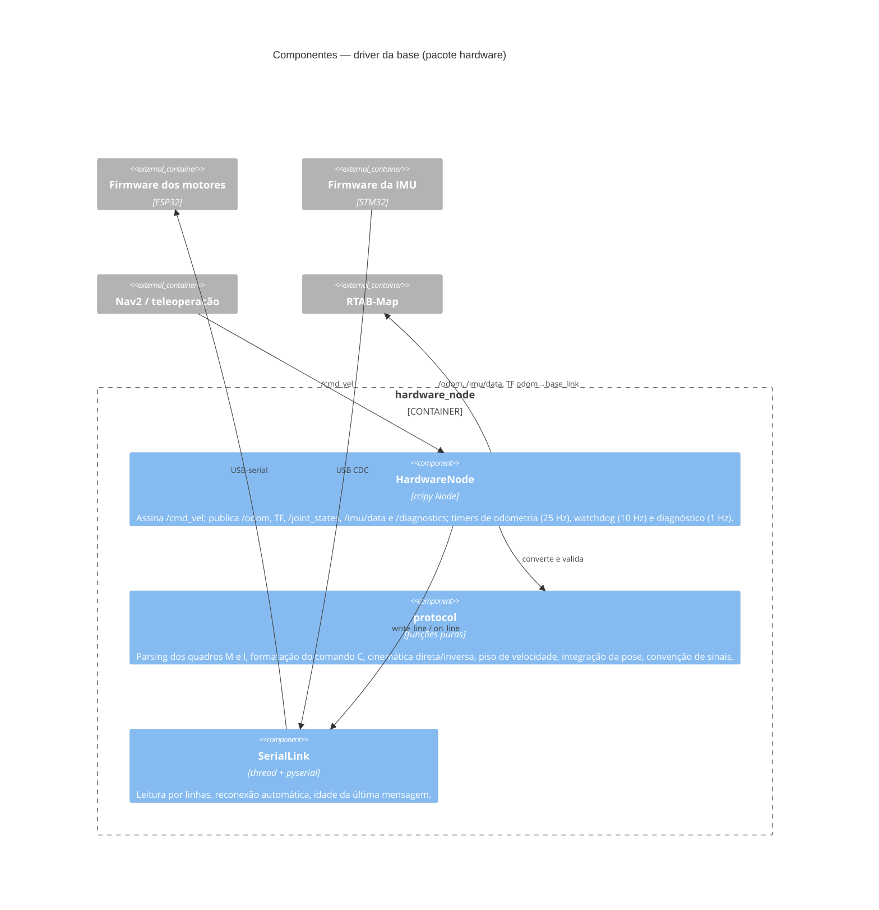

### 3.4 Nível 3 — Componentes do backend web

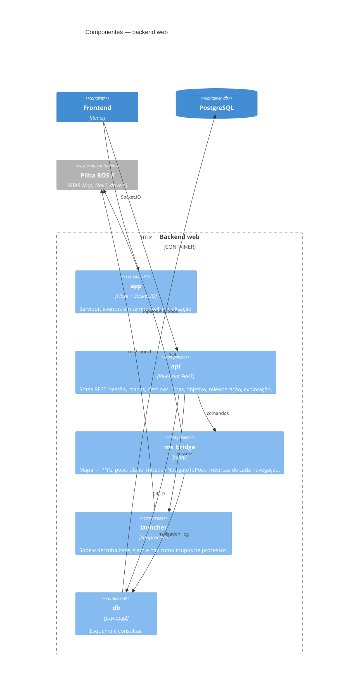

**Fundamentação.** O nível 2 mostra a decisão central da arquitetura: o
**tempo real fica nos microcontroladores** (malha de velocidade de cada roda
com FOC, watchdog local) e a **autonomia fica no ROS 2** (SLAM, planejamento),
ligados por um protocolo de texto simples. Os componentes do driver separam a
lógica pura (`protocol`, testável sem ROS nem hardware) da E/S (`SerialLink`) e
da integração com o ROS (`HardwareNode`).

---

## 4. Diagrama de definição de blocos (SysML BDD)

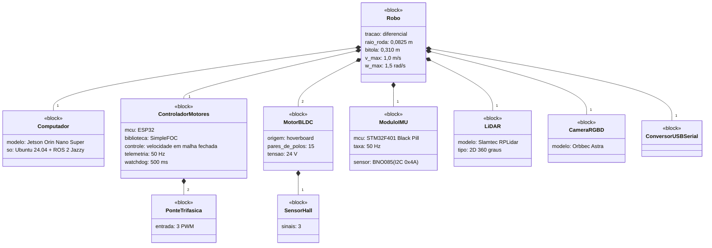

**Descrição.** O robô é composto por um computador de alto nível e por dois
subsistemas de tempo real com microcontrolador próprio. Cada motor tem sua
ponte trifásica, comandada por 3 sinais PWM, e seus 3 sensores Hall, lidos pelo
mesmo ESP32. Os valores (raio, bitola, limites, pares de polos) são os de
`bringup/config/hardware.yaml`, do URDF e do firmware.

---

## 5. Diagrama de blocos internos (SysML IBD)

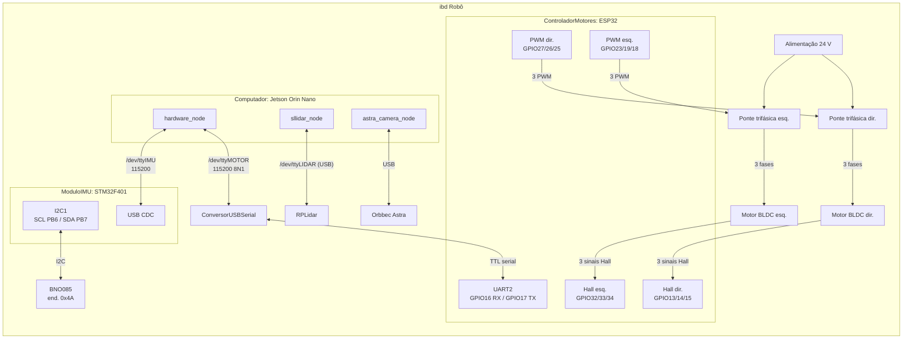

**Descrição.** Mostra as portas e os conectores reais: pinos do ESP32
(`hardware/firmware/esp32_motor_controller`), barramento I2C do STM32
(`hardware/firmware/stm32_imu`) e os nomes fixos de dispositivo criados pelas
regras udev (`bringup/udev/99-robot.rules`). O ESP32 fala com o Jetson pela
UART2 através de um conversor USB-serial, o que deixa a USB nativa livre para
depuração; o STM32 usa a USB CDC nativa.

---

## 6. Malhas de controle

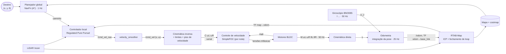

**Descrição.** Três malhas em cascata, cada uma mais rápida que a de fora:

1. **Malha interna (ESP32):** controle de velocidade de cada roda com FOC e
   realimentação dos sensores Hall; roda no microcontrolador e não depende do
   computador.
2. **Malha intermediária (hardware_node):** converte (v, ω) em velocidade das
   rodas, aplica limites e o piso de velocidade (abaixo de 1,5 rad/s o BLDC com
   Hall vibra em vez de girar), e devolve a odometria. A velocidade linear vem
   dos encoders e a angular do **giroscópio**, que não sofre com o
   escorregamento das rodas nas curvas.
3. **Malha externa (Nav2 + RTAB-Map):** segue o caminho com Regulated Pure
   Pursuit sobre a pose corrigida pelo SLAM (TF `map→odom`), replanejando a
   1 Hz.

---

## 7. Máquinas de estado da exploração autônoma

### 7.1 Seguir parede + BFS (`wall_bfs_explorer.py`)

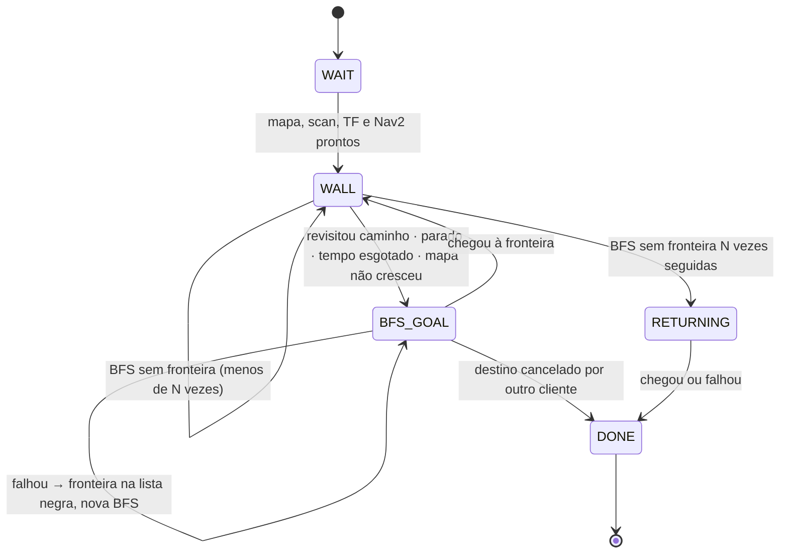

### 7.2 Desbaste em offsets (`pocket_explorer.py`)

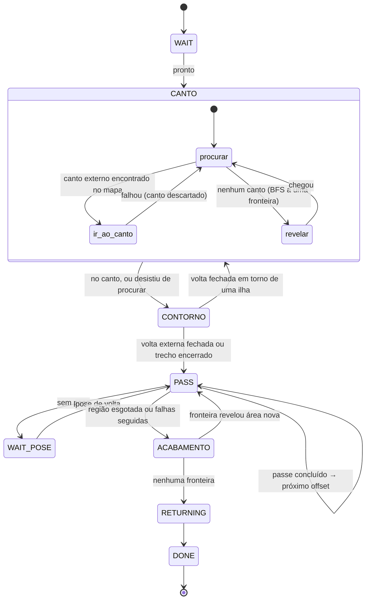

**Descrição.** As duas estratégias combinam um comportamento **reativo**
(seguir parede, comandando `/cmd_vel` direto a partir do `/scan`) com um
**deliberativo** (BFS no mapa ou passes planejados, executados pelo Nav2). As
transições vêm de critérios medidos (distância percorrida sobre caminho já
feito, crescimento da área conhecida, tempo sem progresso), todos
parametrizados em `navigation/config/explore.yaml` e cobertos por testes em
`tests/test_*_explorer.py`.

---

## 8. Camadas de segurança

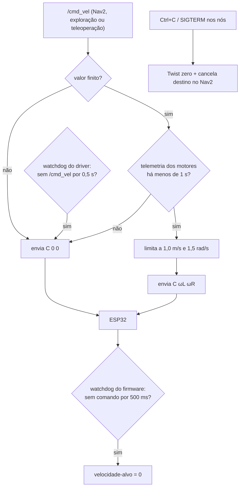

**Descrição.** A parada é garantida em camadas independentes: se o computador
travar, o firmware para sozinho; se o firmware parar de responder, o driver
recusa comandos; se ninguém mandar comando, o driver para. Todas as decisões
do driver são verificadas em `tests/test_hardware_node.py`.
