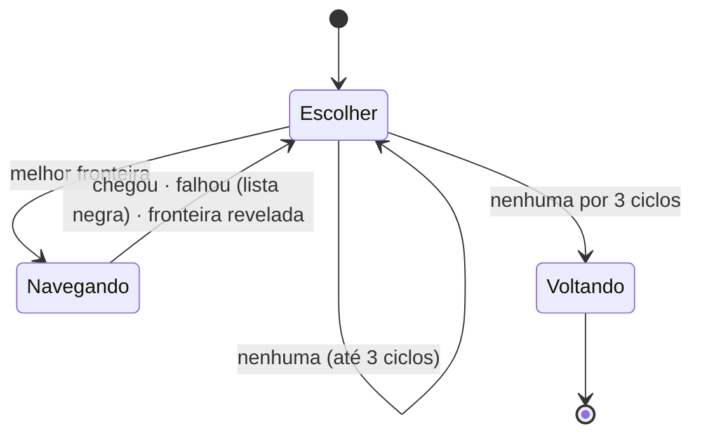
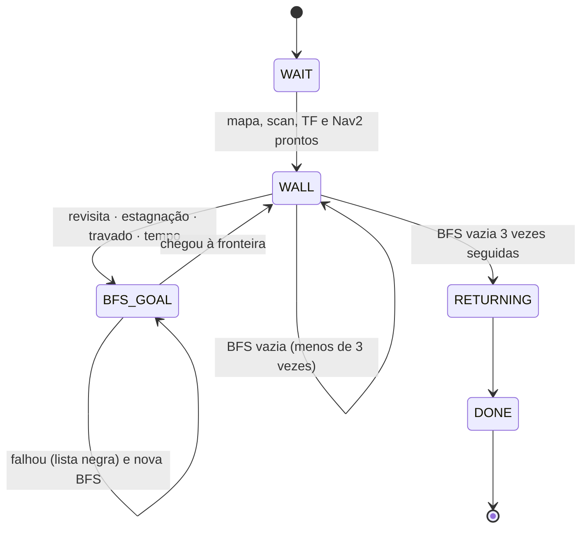
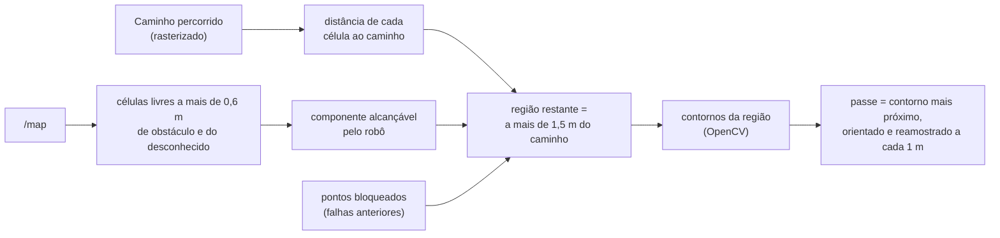
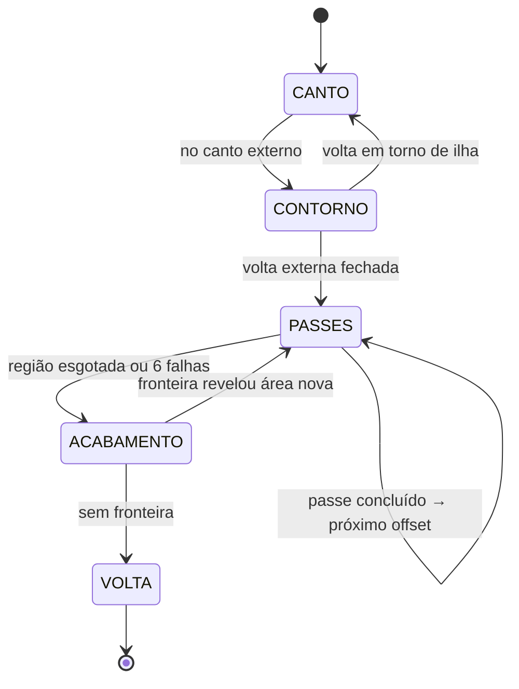

# Exploração autônoma

Durante o **mapeamento**, o robô pode decidir sozinho para onde ir até cobrir o
ambiente inteiro. O projeto tem três estratégias, escolhidas na interface
("Iniciar exploração autônoma") ou por `ros2 launch navigation
explore.launch.py strategy:=<nome>`:

| Estratégia | Ideia | Movimento | Arquivos |
|---|---|---|---|
| `frontier` | ir sempre à melhor fronteira do mapa | Nav2 | `frontier_explorer.py`, `frontiers.py` |
| `wall_bfs` (padrão) | seguir a parede; quando ela não rende, BFS até a fronteira mais próxima | reativo (`/cmd_vel`) + Nav2 | `wall_bfs_explorer.py`, `wall_bfs.py` |
| `pocket` | contornar a parede externa e depois varrer em passes concêntricos, como uma fresa CNC | reativo + Nav2 | `pocket_explorer.py`, `pocket.py` |

Todas pressupõem o RTAB-Map em modo mapeamento e o Nav2 com
`allow_unknown:=true`. A lógica geométrica de cada estratégia está em módulos
**sem ROS** (`frontiers.py`, `wall_bfs.py`, `pocket.py`), testados
isoladamente; os nós ROS só fazem a integração (mapa, TF, actions).

---

## 1. Conceito comum: fronteira

O `/map` é um grid de ocupação: `-1` desconhecido, `0` livre, `100` ocupado
(valores de 0 a 25 contam como livres). Uma **fronteira** é uma célula **livre
vizinha de uma desconhecida** (4-vizinhança): a borda entre o que o robô já
viu e o que falta ver (Yamauchi, 1997).

```
? ? ? ? ?        ? = desconhecido
? F F F ?        F = fronteira (livre, encostada no desconhecido)
. . . . #        . = livre
. R . . #        # = ocupado
# # # # #        R = robô
```

Células de fronteira vizinhas (8-vizinhança) formam **agrupamentos**;
agrupamentos menores que um tamanho mínimo são descartados como ruído
(`min_frontier_size`). O mapa está completo quando não sobra fronteira
**alcançável**.

Mecanismos comuns às três estratégias:

- **Lista negra**: um destino que falhou (Nav2 não chegou, recusou, robô sem
  progresso, tempo esgotado) é descartado num raio (`blacklist_radius`). Um
  destino **atingido** também entra na lista: se ali ainda há fronteira, ela
  não se revela (por exemplo, um vidro, que o LiDAR atravessa).
- **Progresso**: indo a um destino, o robô precisa andar um mínimo a cada
  `progress_timeout` s; senão o destino é cancelado.
- **Fim**: sem fronteira alcançável, o robô volta ao ponto de partida
  (`return_to_start`) e o nó encerra.
- **Cancelamento externo**: se outro cliente (a interface) cancelar o destino,
  a exploração encerra. Assim, o operador sempre tem a última palavra.

---

## 2. `frontier`: fronteiras pelo Nav2

A estratégia clássica. A cada segundo:

1. Encontra os agrupamentos de fronteira no `/map`.
2. Para cada um, procura a célula **mais central que esteja livre no costmap
   global** (custo < 90). O centróide de uma fronteira curva pode cair numa
   parede ou no desconhecido; por isso o destino é a célula da própria
   fronteira mais próxima do centróide, e as seguintes são alternativas.
3. Dá uma nota a cada candidato e escolhe a **menor**:

   $$\text{nota} = w_d \cdot d - w_s \cdot s$$

   com $d$ a distância em linha reta até o robô e $s$ o tamanho da fronteira
   em metros. Com $w_d = 1{,}0$ e $w_s = 0{,}5$, uma fronteira 2 m maior
   compensa estar 1 m mais longe.
4. Manda o Nav2 até lá, com a orientação final apontando do robô para o
   destino.
5. Enquanto navega, troca de destino se a fronteira **sumiu** (o robô já a
   revelou pelo caminho, a mais de 0,5 m de qualquer fronteira atual).



**Limitações:** a distância em linha reta não é a distância pelo caminho
(uma fronteira atrás da parede parece perto); e o robô vai sempre pelo
planejador global, que evita as paredes por causa da inflação, então só vê as
paredes de longe e pode deixar cantos sem mapear.

---

## 3. `wall_bfs`: seguir parede + BFS

Combina um comportamento **reativo** (seguir a parede direto pelo LiDAR, sem
planejamento) com um **deliberativo** (busca no mapa). A ideia: seguir a parede
contorna o ambiente e as prateleiras com o LiDAR sempre perto do que precisa
ser mapeado; a busca só entra quando seguir a parede deixa de revelar mapa.

### 3.1 Seguidor de parede (`wall_follow_command`)

O scan é resumido em quatro setores (no referencial do robô, já descontada a
montagem do LiDAR):

| Setor | Ângulo | Largura |
|---|---|---|
| frente | 0° | ±25° |
| lateral (lado da parede) | ±90° | ±15° |
| diagonal à frente (lado da parede) | ±45° | ±12° |
| outro lado | ∓90° | ±15° |

E a cada 0,1 s um de quatro comportamentos:

| Estado | Condição | Comando |
|---|---|---|
| `turn` | obstáculo à frente a menos de 0,75 m | gira no lugar, para longe da parede |
| `corner` | a parede sumiu há menos de 4 s | anda devagar curvando **para** a parede (contorna a quina) |
| `seek` | sem parede (> 1,40 m) | anda reto procurando uma |
| `follow` | parede presente | controle proporcional (abaixo) |

No `follow`, com $s = \pm1$ conforme o lado:

$$e_d = d_{lat} - d_{ref} \qquad
e_a = \frac{\min(d_{diag}, 2 d_{perda}) - d_{lat}/\cos 45°}{d_{lat}/\cos 45°}$$

$$\omega = s\,(k_p\,e_d + k_a\,e_a), \quad |\omega| \le 0{,}8 \text{ rad/s}$$

- $e_d$ é o erro de distância à parede ($d_{ref} = 0{,}70$ m, cerca de 45 cm
  de folga entre o corpo e a parede).
- $e_a$ é um erro de **ângulo** estimado sem calcular ângulo: se o robô está
  paralelo à parede, a leitura a 45° vale $d_{lat}/\cos 45°$. Se é maior, a
  parede está "abrindo" (o robô aponta para fora) e ele deve virar para ela; se
  é menor, a parede está "fechando" à frente.
- A velocidade linear cai nas curvas ($1 - 0{,}6\,|\omega|/\omega_{max}$) e
  ao se aproximar de um obstáculo à frente (redução linear na faixa de 1 m
  antes da distância de giro), sempre acima do piso de 0,12 m/s das rodas
  BLDC.

### 3.2 Quando largar a parede

Seguir a parede pode nunca terminar (dar voltas numa gôndola, por exemplo). O
trecho de parede termina com o primeiro destes critérios:

| Critério | Medida |
|---|---|
| **Revisita** | o robô andou 1 m, **no mesmo sentido** (diferença de orientação < 60°), a menos de 0,6 m de um caminho que ele já percorreu (do trecho atual, a mais de 4 m para trás, ou de trechos anteriores) |
| **Estagnação** | o mapa cresceu menos de 0,5 m² em 25 s |
| **Travado** | andou menos de 10 cm em 10 s |
| **Tempo** | trecho com mais de 180 s |

A revisita usa o **caminho percorrido** (`PathMemory`): um ponto a cada 5 cm
com a orientação e a distância acumulada. O **sentido** é o que distingue
"estou repetindo a volta" (mesmo sentido) de "estou no outro lado do mesmo
corredor ou da mesma gôndola" (sentido oposto, que é parede nova).

### 3.3 BFS até a fronteira

Quando a parede termina, uma **busca em largura** (BFS) no `/map` parte da
célula do robô e expande pelas células **atravessáveis** (livres e a mais de
0,33 m de qualquer obstáculo, ou seja, onde o corpo cabe), em 8-vizinhança e
sem cortar quina na diagonal. A **primeira** célula de fronteira alcançada é o
destino.

Como a BFS expande por camadas a partir do robô, a primeira fronteira achada é
a mais próxima **pelo caminho**, e não em linha reta: uma fronteira do outro
lado da parede só é alcançada contornando-a. É a diferença fundamental para a
estratégia `frontier`.

Detalhes:

- Fronteiras na lista negra são apagadas dos alvos antes da busca.
- Se o robô estiver colado na parede (dentro da margem de 0,33 m), um disco
  livre em volta dele é somado à máscara, para a busca conseguir sair.
- A orientação final é a direção dos últimos passos do caminho: o robô chega
  de frente para o desconhecido.

Ao chegar, volta a seguir a parede. Se a BFS não acha fronteira, segue a
parede mais um pouco; após 3 buscas vazias seguidas, termina.



---

## 4. `pocket`: desbaste em offsets

Estratégia original deste trabalho, inspirada no **pocketing** de usinagem
CNC: para esvaziar uma cavidade, a fresa primeiro contorna a borda e depois faz
passes paralelos, cada um deslocado do anterior por um passo lateral
(*stepover*), até o centro. Aqui o "material" a remover é a área que o robô
ainda não viu de perto.

O objetivo é uma cobertura **sistemática e previsível**, que passa a uma
distância controlada de todo o ambiente, em vez da sequência oportunista das
outras estratégias.

### 4.1 Achar a parede externa no mapa (visão computacional)

Seguir "a parede mais próxima" pode começar numa gôndola, e o robô contornaria
a ilha em vez do ambiente. Por isso, antes do contorno, o robô identifica no
próprio `/map` um **canto da parede externa** (`find_outer_corners`):

1. **Silhueta**: o espaço livre passa por um fechamento morfológico (tapa
   falhas de leitura) e tem os **buracos preenchidos**. Prateleiras e pilares
   são ilhas cercadas de espaço livre e somem; sobra a maior componente,
   limitada pelas paredes externas.
2. **Polígono**: o contorno externo da silhueta é simplificado pelo algoritmo
   de **Douglas-Peucker** (tolerância 0,25 m).
3. **Cantos**: um vértice do polígono é canto de parede externa se:
   - é **convexo**, com curva entre 45° e 135°;
   - as duas arestas têm pelo menos 1,5 m;
   - pelo menos 70% de cada aresta tem célula **ocupada** atrás (descarta
     bordas com o desconhecido, que não são parede);
   - está a até 0,6 m do **fecho convexo** (descarta reentrâncias).
4. **Ponto de chegada**: a 0,70 m das duas paredes, do lado de dentro, com a
   orientação da parede seguinte (parede à direita).

O robô vai pelo Nav2 ao canto mais próximo cujo ponto de chegada seja
atravessável. Sem canto visível (mapa ainda pequeno), vai a uma fronteira pela
BFS para revelar mais mapa e tenta de novo (até 4 vezes).

### 4.2 Nível 0: contorno

A partir do canto, segue a parede externa (mesmo seguidor de parede da seção
3.1) até **fechar a volta**, ou seja, até revisitar o próprio caminho. Ao
contrário do `wall_bfs`, a estagnação do mapa **não** encerra o contorno:
do canto o mapa pode já ter sido todo visto, e "não cresceu" não quer dizer que
a parede acabou.

Ao fechar, verifica se a volta foi mesmo **por fora**: com a parede à direita,
contornar o ambiente por dentro é andar no sentido **anti-horário** (o
interior fica à esquerda); contornar uma ilha é andar no horário. O sentido sai
do sinal da **área do polígono** do caminho (fórmula do laço / *shoelace*):

$$A = \tfrac{1}{2}\sum_i (x_i\,y_{i+1} - x_{i+1}\,y_i)$$

$A > 0$ é anti-horário. Se a volta foi em torno de uma ilha, o canto é
descartado e o robô procura outro (até 2 vezes).

### 4.3 Níveis 1..N: passes em offset

Cada passe é um **offset de tudo o que o robô já percorreu**:



1. **Região restante**: células livres, a mais de 0,6 m de obstáculos e do
   desconhecido (`pass_clearance`), na componente alcançável pelo robô, e a
   mais de 1,5 m (`level_spacing`, o *stepover*) de todo o caminho já feito.
   Pedaços menores que 1 m² são descartados.
2. **Passe**: a borda dessa região, que é exatamente a curva a 1,5 m do que
   já foi percorrido. Escolhe-se o contorno mais próximo do robô, começando no
   ponto mais próximo dele.
3. **Orientação**: o contorno é percorrido de modo que a região ainda não
   varrida fique à esquerda e o já feito à direita (o lado da parede), no
   mesmo sentido do contorno externo.
4. **Execução**: o contorno é reamostrado a cada 1 m e enviado ao Nav2 de uma
   vez, como `NavigateThroughPoses`, com a orientação de cada ponto apontando
   para o próximo.
5. Percorrido o passe, ele entra no caminho percorrido, a região encolhe, e o
   próximo passe é o offset dele. Repete até a região acabar.

Os passes são feitos pelo Nav2, e não pelo seguidor de parede, porque no meio
do ambiente não há parede para seguir: o passe é uma curva calculada.

**Falhas**: o *feedback* do Nav2 informa quantos pontos faltam; o ponto que o
robô não alcançou vira um disco **bloqueado** de 0,8 m, que sai dos próximos
passes. Sem progresso por 30 s ou com o passe passando do tempo estimado
($\max(180\,\text{s},\ 60\,\text{s} + \text{comprimento}/0{,}15\,\text{m/s})$),
o passe é cancelado. Seis falhas seguidas levam direto ao acabamento.

### 4.4 Acabamento

Sem região para desbastar, sobram as fronteiras que os passes não revelaram
(atrás de prateleiras, cantos estreitos). A BFS da seção 3.3 visita cada uma;
uma chegada que revela área nova volta para os passes. Sem fronteira, volta ao
início e encerra.



---

## 5. Comparação

| | `frontier` | `wall_bfs` | `pocket` |
|---|---|---|---|
| Critério de escolha | nota distância × tamanho (linha reta) | fronteira mais próxima pelo caminho | geometria: offsets do já percorrido |
| Distância das paredes | longe (inflação do planejador) | 0,70 m (seguidor de parede) | 0,70 m no contorno; passes a 1,5 m entre si |
| Previsibilidade do trajeto | baixa | média | alta |
| Cobertura | até não haver fronteira | até não haver fronteira | sistemática (passes) + fronteiras restantes |
| Depende do Nav2 | sempre | só para ir às fronteiras | para canto, passes e acabamento |
| Parâmetros | `frontier_explorer` em `explore.yaml` | `wall_bfs_explorer` | `pocket_explorer` |

Para comparar as estratégias no mesmo mundo simulado, observam-se o tempo até
o fim da exploração, a distância percorrida e a área conhecida do mapa final
(registrados nos logs do explorador e no `.db` do RTAB-Map).

## Referências

- B. Yamauchi. *A frontier-based approach for autonomous exploration*.
  IEEE CIRA, 1997.
- D. Douglas, T. Peucker. *Algorithms for the reduction of the number of
  points required to represent a digitized line or its caricature*.
  Cartographica, 1973.
- M. Held. *On the Computational Geometry of Pocket Machining*. Springer, 1991.
