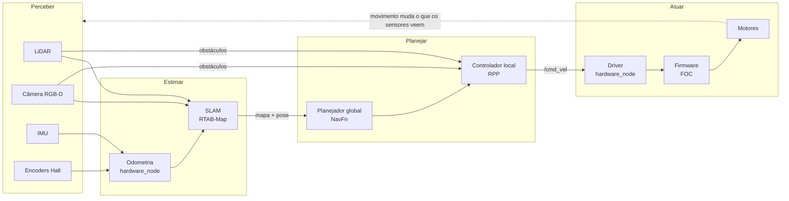
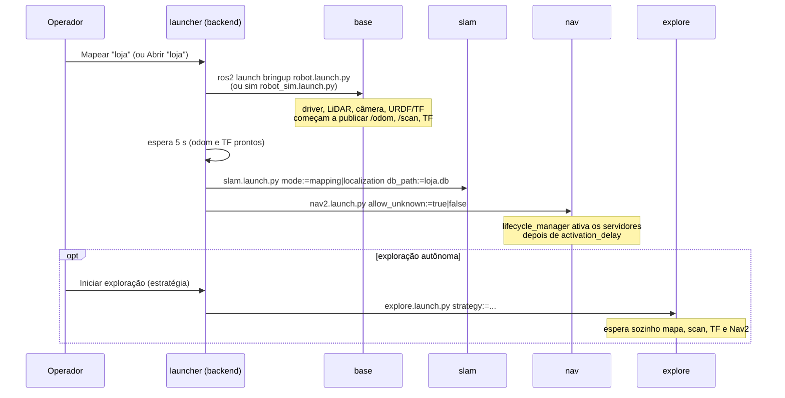
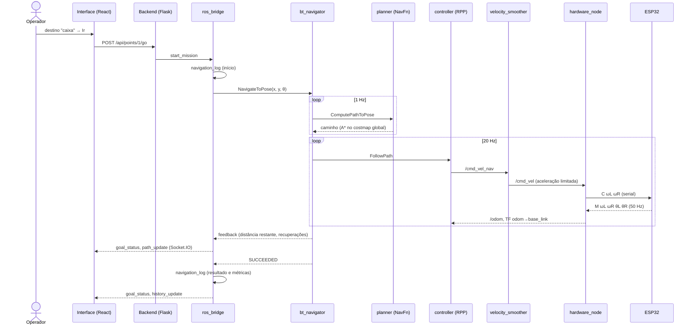
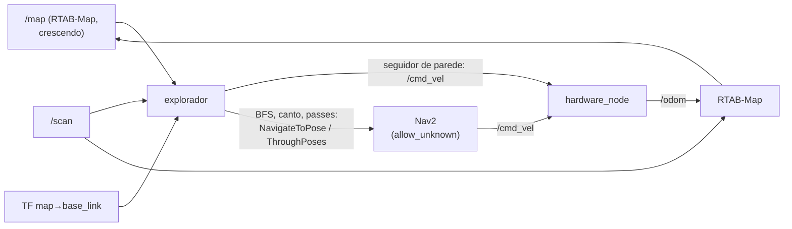
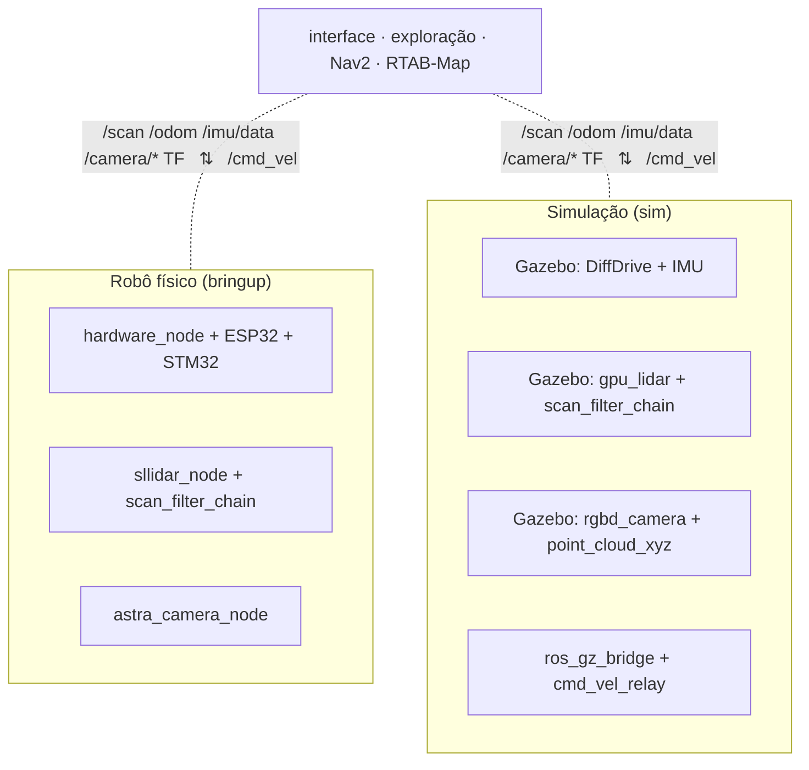

# Como tudo funciona junto

Este documento acompanha o sistema de ponta a ponta: da partida até o robô
chegar a um destino, mostrando como ROS 2, RTAB-Map, Nav2, o driver, os
firmwares e a interface se encaixam. Os detalhes de cada parte estão em:

| Parte | Documento |
|---|---|
| Comunicação, TF, QoS, lifecycle | [ros2.md](ros2.md) |
| Mapeamento e localização | [slam-rtabmap.md](slam-rtabmap.md) |
| Planejamento e controle de trajetória | [navegacao-nav2.md](navegacao-nav2.md) |
| Firmware, driver e odometria | [controle-base.md](controle-base.md) |
| Exploração autônoma | [exploracao.md](exploracao.md) |
| Por que foi feito assim | [decisoes-arquitetura.md](decisoes-arquitetura.md) |

---

## 1. Visão geral: perceber, estimar, planejar, atuar

Cada caixa roda num ritmo diferente e todas se comunicam por tópicos ROS:

| Laço | Frequência |
|---|---|
| FOC + PID de velocidade (ESP32) | o mais rápido possível, no núcleo 1 |
| Telemetria dos motores e da IMU | 50 Hz |
| Odometria (`hardware_node`) | 25 Hz |
| Controlador local (RPP) e velocity smoother | 20 Hz |
| Costmap local / global | 10 Hz / 3 Hz |
| Seguidor de parede (exploração) | 10 Hz |
| Detecção do RTAB-Map | 10 Hz no mapeamento, 4 Hz na localização |
| Replanejamento global | 1 Hz |

---

## 2. Partida

### 2.1 Pelos scripts

`scripts/start_robot.sh` (ou `start_sim.sh`) compila o workspace e a
interface, sobe o PostgreSQL (Docker) e inicia o **backend web**. O backend
não sobe a pilha ROS sozinho: ele espera o operador escolher o que fazer.

### 2.2 Sessão

O operador escolhe **Mapear** (mapa novo) ou **Abrir** (mapa salvo). O
`launcher.py` do backend sobe a pilha como **processos independentes**, cada um
um `ros2 launch`:

| Processo | Mapeamento | Navegação |
|---|---|---|
| `base` | `bringup/robot.launch.py` ou `sim/robot_sim.launch.py` | idem |
| `slam` | RTAB-Map `mode:=mapping` (cria/estende o `.db`) | RTAB-Map `mode:=localization` (somente leitura) |
| `nav` | Nav2 `allow_unknown:=true` | Nav2 `allow_unknown:=false` |
| `explore` | opcional | — |

Separar em processos permite reiniciar uma parte sem as outras: se o Nav2
falhar ao ativar (o log contém `Failed to bring up all requested nodes`), o
backend reinicia só o `nav`, até duas vezes. Se outro processo morrer, a
sessão inteira é encerrada e o erro aparece na interface.

### 2.3 Encerramento

Parar a sessão envia **SIGINT** (o mesmo que Ctrl+C) a cada processo, em ordem
inversa, com espera antes de escalar para SIGTERM e SIGKILL. O RTAB-Map grava
o `.db` inteiro ao receber o SIGINT, por isso o `slam` tem uma espera de até
60 s. O explorador recebe SIGINT primeiro: cancela o destino no Nav2 e para o
robô antes de sair.

---

## 3. Um destino, do clique à roda

O operador toca em um destino salvo e em **Ir**:

Enquanto isso, em paralelo:

- O **RTAB-Map** recebe `/scan`, câmera e `/odom`, reconhece lugares do mapa e
  publica a correção `map → odom`. O controlador segue o caminho no
  referencial `map`, então a correção entra na trajetória sem saltos no
  comando.
- Os **costmaps** recebem `/scan` e a nuvem da câmera. Se uma pessoa entra na
  frente, o costmap local marca o obstáculo; o RPP desacelera ou para pela
  detecção de colisão, e o próximo replanejamento (1 s) desvia.
- Se o robô ficar preso, a **behavior tree** entra em recuperação (limpar
  costmaps, girar, esperar, recuar) e tenta de novo.
- O `ros_bridge` acompanha a pose (5 Hz) para somar a **distância percorrida**
  e guarda a **menor leitura do LiDAR** para calcular a folga mínima até
  obstáculos.

Ao terminar, a linha de `navigation_log` recebe: resultado, duração, distância,
recuperações, menor folga entre o corpo e um obstáculo e erro final até o
destino. Uma **rota** é a mesma coisa repetida: cada destino da sequência é um
`NavigateToPose` separado, o que permite medir cada trecho.

---

## 4. Mapeamento com exploração autônoma

No mapeamento, o explorador escolhido substitui o operador como "cliente" do
Nav2 e, no caso do seguidor de parede, comanda `/cmd_vel` diretamente:

O laço se fecha: o robô se move, o RTAB-Map amplia o mapa, o explorador decide
o próximo movimento com o mapa novo. Os dois comandos de velocidade nunca
competem: enquanto segue a parede, o explorador não tem destino ativo no Nav2,
e antes de enviar um destino ele para o robô.

---

## 5. Simulação e robô físico

A decisão central da arquitetura é que **as duas bases publicam os mesmos
tópicos**. Tudo acima da linha tracejada é idêntico:

As únicas diferenças acima da base são `use_sim_time:=true` (relógio do
Gazebo) e a variável `ROBOT_SIM=1` no backend, que escolhe qual launch de base
subir. Com isso, toda versão é testada no supermercado e na loja simulados,
inclusive com pessoas caminhando, antes de ir ao robô.

O Gazebo também publica a **pose real** do robô (`/ground_truth/odom`),
que `tools/metrics/localization_error.py` compara com a pose estimada pelo
RTAB-Map para medir o erro de localização.
