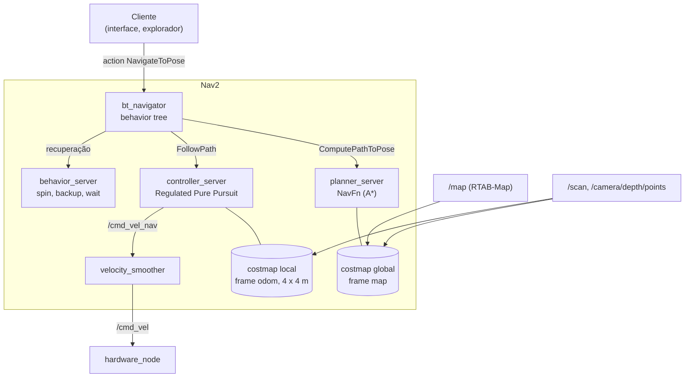

# Navegação com Nav2

O **Nav2** é a pilha de navegação do ROS 2. Recebe um destino e leva o robô até
ele: planeja o caminho, segue o caminho desviando de obstáculos e se recupera
quando fica preso. Toda a configuração do projeto está em
`navigation/config/nav2_params.yaml`.

## 1. Arquitetura



Cada servidor carrega seus algoritmos como **plugins**; a orquestração fica na
**behavior tree** (árvore de comportamento) do `bt_navigator`.

## 2. Behavior tree

O projeto usa a árvore padrão `navigate_to_pose_w_replanning_and_recovery`:

1. **Replaneja a 1 Hz**: a cada segundo pede um caminho novo ao
   `planner_server`, a partir da pose atual. Assim o caminho acompanha os
   obstáculos que aparecem.
2. **Segue o caminho** com o `controller_server`.
3. **Se falhar** (controlador sem progresso, caminho impossível), entra na
   sequência de recuperação: limpa os costmaps, gira, espera, recua, e tenta
   de novo. Esgotadas as tentativas, a action termina com `ABORTED`.

O número de recuperações vem no *feedback* da action e é gravado pela
interface em `navigation_log`.

## 3. Costmaps

Um **costmap** é um grid em que cada célula tem um custo de 0 (livre) a 254
(letal). Ele é montado em **camadas**:

| Camada | Costmap global | Costmap local |
|---|---|---|
| Estática (`/map` do RTAB-Map) | sim | não |
| Obstáculos — LiDAR (`/scan`), marca até 3 m, limpa até 4 m | sim | sim |
| Obstáculos — câmera (`/camera/depth/points`), até 2,5 m | sim, objetos de 0,35 a 1,80 m de altura | sim, de 0,10 a 1,80 m |
| Inflação (raio 0,60 m, fator 2,0) | sim | sim |
| Frame / tamanho | `map`, mapa inteiro | `odom`, janela móvel de 4 × 4 m |

- **Marcar e limpar**: cada feixe do LiDAR marca o ponto onde bateu e limpa
  (*ray tracing*) as células por onde passou. Uma pessoa que se afasta é
  apagada do costmap. `inf_is_valid: true` faz um feixe sem retorno limpar o
  caminho até o alcance máximo.
- **A câmera** vê o que o laser não vê: mesas e prateleiras acima do plano do
  LiDAR, objetos baixos no chão.
- **Inflação**: em volta de cada obstáculo, o custo decai com a distância. O
  `robot_radius: 0.33` torna letal tudo a menos de 33 cm (o corpo tem raio de
  24,5 cm e está deslocado 7,5 cm do eixo das rodas); além disso, o custo cai
  devagar até 0,60 m, então o planejador prefere passar longe das paredes.
- **Local em `odom`**: o costmap local acompanha o robô pela odometria, que é
  contínua; assim um salto de correção do SLAM não desloca os obstáculos que o
  controlador está evitando.

## 4. Planejador global: NavFn com A*

O `planner_server` usa o **NavFn** com A* (`use_astar: true`) sobre o costmap
global: encontra o caminho de menor custo acumulado, levando em conta a
inflação, do robô até o destino. `tolerance: 0.5` aceita terminar até 0,5 m do
destino se ele mesmo estiver bloqueado.

`allow_unknown` é a chave entre os dois modos de operação:

- **Navegação** (`false`): só planeja por espaço conhecido.
- **Mapeamento** (`true`, passado pelo launch): planeja atravessando o
  desconhecido. É isso que permite mandar o robô para uma fronteira ainda não
  mapeada.

## 5. Controlador local: Regulated Pure Pursuit

O **Pure Pursuit** escolhe um ponto do caminho a uma distância à frente (o
*lookahead*, a "cenoura") e comanda o arco de circunferência que leva o robô
até ele. A curvatura do arco é

$$\kappa = \frac{2\,y_c}{L^2}$$

onde $y_c$ é o deslocamento lateral da cenoura no referencial do robô e $L$ a
distância até ela; a velocidade angular é $\omega = v\,\kappa$.

A versão **Regulated** (Macenski et al., 2023) ajusta a velocidade linear a
partir do contexto, e o projeto configura:

| Parâmetro | Valor | Por quê |
|---|---|---|
| `desired_linear_vel` | 0,8 m/s | velocidade de cruzeiro em ambiente com pessoas |
| `lookahead_time` + limites | 1,5 s, entre 0,42 e 1,5 m | *lookahead* proporcional à velocidade: longe em reta, perto em manobra |
| `regulated_linear_scaling_min_radius` | 0,9 m | desacelera em curvas mais fechadas que isso |
| `min_approach_linear_velocity` / `regulated_linear_scaling_min_speed` | 0,17 m/s | abaixo disso o piso das rodas BLDC gera trancos ([controle-base.md](controle-base.md)) |
| `use_collision_detection` | 1,5 s à frente | para se o arco projetado colidir em menos de 1,5 s (~1,2 m a 0,8 m/s) |
| `use_rotate_to_heading` | acima de 45° | gira no lugar antes de andar quando o caminho começa para trás ou para o lado |
| `allow_reversing` | `false` | o robô não tem sensores voltados só para trás; não anda de ré no seguimento |

O **progress checker** declara falha se o robô não andar 0,3 m em 15 s; o
**goal checker** considera o destino atingido a 0,20 m e 0,25 rad.

## 6. Velocity smoother

Entre o controlador e o robô, o `velocity_smoother` limita a aceleração
(0,5 m/s², frenagem de 0,8 m/s², 2 rad/s² angular) e aplica uma zona morta
(abaixo de 0,03 m/s e 0,10 rad/s vira zero), o que suaviza partidas e
paradas. A cadeia é:

```
controller_server → /cmd_vel_nav → velocity_smoother → /cmd_vel → hardware_node
```

## 7. Recuperações

O `behavior_server` oferece `spin` (girar no lugar, para o LiDAR revelar o
entorno), `backup` (recuar), `drive_on_heading` e `wait` (esperar, por exemplo,
uma pessoa sair da frente). A velocidade de giro fica entre 0,70 e 0,84 rad/s,
acima do piso das rodas.

## 8. Ativação

Os servidores são *lifecycle nodes* ativados pelo `lifecycle_manager`, que sobe
com atraso para não falhar antes do relógio da simulação
([ros2.md §6](ros2.md#6-nós-com-ciclo-de-vida-lifecycle)).

## Referências

- S. Macenski et al. *The Marathon 2: A Navigation System*. IROS, 2020.
- S. Macenski et al. *Regulated Pure Pursuit for Robot Path Tracking*.
  Autonomous Robots, 2023.
- Documentação: <https://docs.nav2.org>
