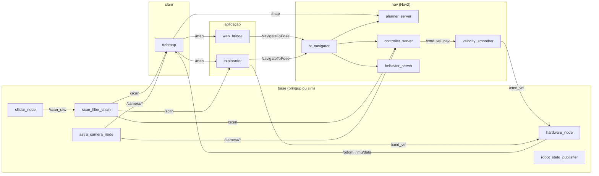
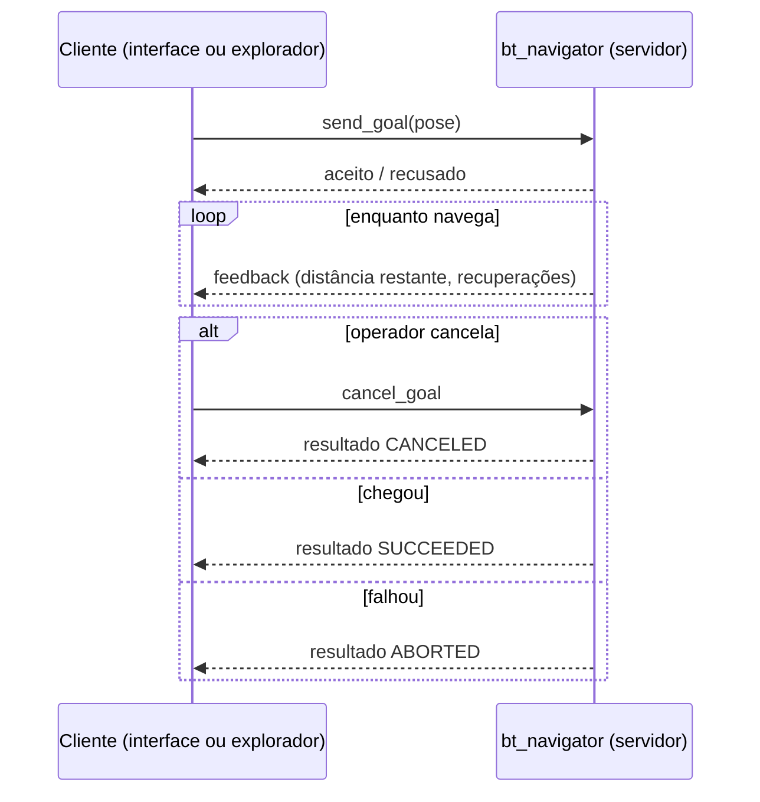
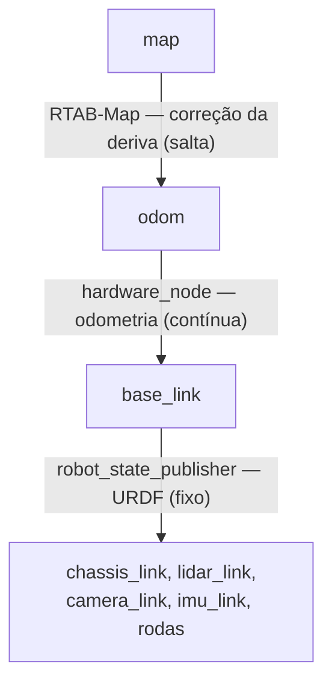

# ROS 2 no projeto

O **ROS 2** (Robot Operating System 2) não é um sistema operacional: é um
*middleware* e um conjunto de bibliotecas e ferramentas para software de
robôs. Ele resolve três problemas que todo robô tem:

1. **Comunicação** entre programas independentes (sensores, SLAM,
   planejamento, controle), em tempo real e de forma tipada.
2. **Geometria**: onde está cada sensor e cada peça do robô em relação ao
   mundo, a cada instante (biblioteca TF2).
3. **Ecossistema**: drivers de sensores e algoritmos prontos (RTAB-Map, Nav2)
   que falam a mesma "língua" de mensagens.

O projeto usa a distribuição **Jazzy Jalisco** (LTS, maio de 2024 a maio de
2029) sobre Ubuntu 24.04.

---

## 1. Grafo de computação

Um sistema ROS é um **grafo**: os vértices são **nós** (processos ou partes de
processos) e as arestas são canais de comunicação. Os nós se descobrem sozinhos
na rede, sem servidor central, pelo **DDS** (*Data Distribution Service*), o
padrão de publicação/assinatura sobre o qual o ROS 2 é construído.

Os nós do projeto estão em três grupos de processos (`base`, `slam`, `nav`),
mais o explorador e o backend web, que sobem e descem de forma independente
(ver [integracao.md](integracao.md)).

---

## 2. Formas de comunicação

| Padrão | Semântica | Uso no projeto |
|---|---|---|
| **Tópico** | publicação/assinatura, muitos-para-muitos, assíncrono | fluxo contínuo de dados: `/scan`, `/odom`, `/map`, `/cmd_vel` |
| **Serviço** | requisição/resposta, síncrono e curto | ativação dos nós do Nav2 pelo `lifecycle_manager` |
| **Action** | objetivo de longa duração, com *feedback* periódico, resultado e cancelamento | `NavigateToPose` (ir a um destino), `NavigateThroughPoses` (passes da exploração) |
| **Parâmetro** | configuração de cada nó, carregada de YAML e alterável em execução | todos os nós (`bringup/config`, `navigation/config`) |

### Tópicos principais

| Tópico | Tipo | Publicado por | Consumido por |
|---|---|---|---|
| `/scan_raw` | `sensor_msgs/LaserScan` | `sllidar_node` (real) / Gazebo | `scan_filter_chain` |
| `/scan` | `sensor_msgs/LaserScan` | `scan_filter_chain` | RTAB-Map, costmaps do Nav2, exploração, interface |
| `/camera/color/image_raw`, `/camera/depth/image_raw` | `sensor_msgs/Image` | driver da Astra / Gazebo | RTAB-Map |
| `/camera/depth/points` | `sensor_msgs/PointCloud2` | driver da Astra / `point_cloud_xyz` (rtabmap_util) na simulação | costmaps do Nav2 |
| `/odom` | `nav_msgs/Odometry` | `hardware_node` (25 Hz) / DiffDrive | RTAB-Map, Nav2 |
| `/imu/data` | `sensor_msgs/Imu` | `hardware_node` (50 Hz) / Gazebo | RTAB-Map |
| `/joint_states` | `sensor_msgs/JointState` | `hardware_node` / Gazebo | `robot_state_publisher` |
| `/map` | `nav_msgs/OccupancyGrid` | RTAB-Map | Nav2 (camada estática), exploração, interface |
| `/plan` | `nav_msgs/Path` | `planner_server` | interface |
| `/cmd_vel_nav` | `geometry_msgs/Twist` | `controller_server` | `velocity_smoother` |
| `/cmd_vel` | `geometry_msgs/Twist` | `velocity_smoother`, seguidor de parede, teleoperação | `hardware_node` / `cmd_vel_relay` |
| `/initialpose` | `geometry_msgs/PoseWithCovarianceStamped` | interface ("Corrigir posição") | RTAB-Map |
| `/diagnostics` | `diagnostic_msgs/DiagnosticArray` | `hardware_node` (1 Hz) | interface |
| `/clock` | `rosgraph_msgs/Clock` | Gazebo (só simulação) | todos os nós com `use_sim_time` |

### Actions: por que destinos não são tópicos

Ir até um destino leva segundos ou minutos, pode falhar e pode ser cancelado.
A **action** `NavigateToPose` modela exatamente isso:

O projeto usa os três desfechos: a interface grava cada um em
`navigation_log`; os exploradores põem o destino que falhou numa lista negra; e
um `CANCELED` que eles não pediram (outro cliente cancelou, por exemplo a
interface) encerra a exploração.

---

## 3. Qualidade de serviço (QoS)

Cada tópico tem um perfil de QoS, e publicador e assinante precisam ser
compatíveis. O projeto usa três perfis:

| Perfil | Configuração | Onde | Por quê |
|---|---|---|---|
| Sensor | `BEST_EFFORT`, `VOLATILE`, fila curta | `/scan`, imagens | uma leitura atrasada não vale nada; melhor perder do que acumular |
| Confiável | `RELIABLE`, `VOLATILE` | `/cmd_vel`, `/odom`, costmap | toda mensagem importa |
| Mapa | `RELIABLE`, **`TRANSIENT_LOCAL`**, profundidade 1 | `/map` | quem assina depois (Nav2, interface, explorador que sobe no meio do mapeamento) recebe o último mapa na hora, sem esperar o próximo |

Um erro de QoS não gera exceção: o assinante simplesmente não recebe nada. Por
isso os perfis estão declarados como constantes nos nós (`MAP_QOS` em
`wall_bfs_explorer.py`, `frontier_explorer.py` e `ros_bridge.py`).

---

## 4. TF2: a geometria do robô

O TF2 mantém uma **árvore de referenciais** (*frames*) com as transformações
entre eles, com carimbo de tempo. Qualquer nó pergunta "onde está o frame A
no frame B no instante t?" e o TF2 encadeia as transformações.

O projeto segue a convenção **REP-105**:

- **`odom → base_link`** é contínua e suave, mas acumula erro (deriva). É a
  referência certa para controle de curto prazo (costmap local).
- **`map → odom`** é publicada pelo RTAB-Map e absorve as correções do SLAM.
  Quando um fechamento de loop corrige a pose, é este elo que "salta"; a
  odometria continua suave.
- A composição `map → base_link` é a melhor estimativa da pose global.
- As transformações fixas dos sensores vêm do URDF
  (`description/urdf/robot.urdf.xacro`), publicado pelo
  `robot_state_publisher`. Por isso o RTAB-Map sabe projetar o LiDAR no
  `base_link`, mesmo com o RPLidar montado girado 180°.

Os exploradores consultam o TF diretamente (`lookup_transform(map, base_link)`)
para saber a pose do robô.

---

## 5. Parâmetros, launch e pacotes

- **Parâmetros** ficam em YAML por nó (`bringup/config/hardware.yaml`,
  `navigation/config/*.yaml`) e são declarados no código com valor padrão
  (`declare_parameter`). Os launch files sobrescrevem alguns por argumento,
  como `use_sim_time`, `mode` e `allow_unknown`.
- **Launch files** (Python) sobem conjuntos de nós com seus parâmetros e
  *remapeamentos* de tópico. Exemplo: o `controller_server` publica em
  `cmd_vel`, remapeado para `/cmd_vel_nav`, para que o `velocity_smoother`
  fique no meio do caminho.
- **Pacotes**: `description`, `bringup`, `navigation` e `sim` são
  `ament_cmake` (instalam configs, launches e scripts); `hardware` é
  `ament_python` (o driver é um módulo Python instalável). Tudo é compilado com
  `colcon build --symlink-install`.

---

## 6. Nós com ciclo de vida (*lifecycle*)

Os servidores do Nav2 são **lifecycle nodes**: nascem `unconfigured`, passam a
`inactive` (configurados) e a `active` (operando) sob o comando do
`lifecycle_manager`. Isso garante uma ordem de partida determinística: nenhum
servidor aceita trabalho antes que todos estejam prontos.

O projeto lida com uma armadilha desse mecanismo na simulação (ver
`nav2.launch.py`): se o `lifecycle_manager` ativar os nós antes do primeiro
`/clock`, o costmap acha que a espera pelo TF estourou e a ativação falha. Por
isso o gerenciador sobe com atraso (`activation_delay`), e o backend reinicia o
Nav2 se detectar a falha no log (`launcher.py`, `NAV_BRINGUP_FAILED`).

---

## 7. Tempo simulado

Com `use_sim_time:=true`, todos os nós usam o relógio publicado pelo Gazebo em
`/clock` em vez do relógio do sistema. Assim, se a simulação rodar mais lenta
que o tempo real, os timeouts, a odometria e o TF continuam consistentes entre
si. A exceção proposital é o `cmd_vel_relay`
(`sim/scripts/cmd_vel_relay.py`): o watchdog dele usa o relógio de parede,
como o hardware real.

---

## Referências

- Documentação do ROS 2 Jazzy: <https://docs.ros.org/en/jazzy/>
- REP-105, referenciais de robôs móveis: <https://www.ros.org/reps/rep-0105.html>
- Macenski et al., *Robot Operating System 2: Design, architecture, and uses
  in the wild*, Science Robotics, 2022.
