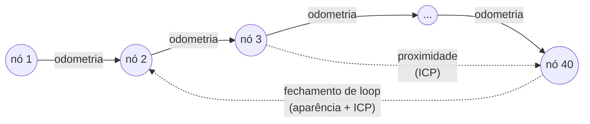

# Mapeamento e localização com RTAB-Map

## 1. O problema: SLAM

Para navegar, o robô precisa de um **mapa** e da sua **pose** nele. Mas para
construir o mapa ele precisa saber onde estava quando viu cada coisa, e para
saber onde está precisa do mapa. Resolver os dois ao mesmo tempo é o problema de
**SLAM** (*Simultaneous Localization and Mapping*).

A odometria das rodas sozinha não basta: ela integra pequenos erros (diâmetro
da roda, escorregamento) e a pose **deriva** sem limite. Depois de uma volta
pela loja, o robô "acha" que está a metros de onde realmente está. O SLAM usa
os sensores externos (LiDAR, câmera) para corrigir essa deriva.

## 2. Como o RTAB-Map funciona

O **RTAB-Map** (*Real-Time Appearance-Based Mapping*, Labbé e Michaud) é um
SLAM **baseado em grafo**:

- **Nós** são "fotografias" do robô num instante: a pose estimada mais os dados
  dos sensores naquele ponto (scan do LiDAR, imagem RGB, profundidade e as
  *features* visuais extraídas dela).
- **Arestas** são restrições geométricas entre dois nós: "o nó B está 5 cm à
  frente do nó A".
  - **Vizinhança**: entre nós consecutivos, vinda da odometria (refinada por
    ICP entre os scans consecutivos).
  - **Fechamento de loop**: o robô reconhece um lugar por onde já passou.
  - **Proximidade**: o robô está perto (no grafo) de um nó antigo, e os scans
    se alinham.
- **Otimização do grafo**: cada fechamento de loop cria uma aresta que
  contradiz a odometria acumulada. O otimizador redistribui o erro por todas
  as arestas, encontrando as poses que melhor satisfazem todas as restrições.
  O mapa inteiro "se endireita".
- **Mapa de ocupação 2D**: depois de otimizado o grafo, o RTAB-Map projeta os
  scans de cada nó na sua pose corrigida e publica o grid em `/map`.

### 2.1 Detecção de fechamento de loop por aparência

A parte "*Appearance-Based*" do nome:

1. De cada imagem RGB extraem-se até 1000 pontos de interesse (detector
   **GFTT**) com descritores **ORB** (`Kp/DetectorStrategy: 8`).
2. Os descritores são quantizados em **palavras visuais** (*bag-of-words*), um
   vocabulário construído incrementalmente.
3. Para cada imagem nova, um **filtro bayesiano** avalia a hipótese "esta
   imagem é o mesmo lugar que o nó X" comparando os histogramas de palavras.
4. Se a hipótese passa do limiar, a transformação entre os dois nós é calculada
   e validada geometricamente: com pelo menos 15 correspondências inliers
   (`Vis/MinInliers`) e, no modo mapeamento, refinada por **ICP** no scan
   (`Reg/Strategy: 1`).
5. Se a otimização com o novo laço gerar erro maior que 3 vezes o esperado
   (`RGBD/OptimizeMaxError`), o laço é rejeitado como falso positivo.

A aparência é poderosa para reconhecer lugares mesmo com muita deriva; o LiDAR
é preciso para medir a transformação. O projeto usa cada sensor no que ele
faz melhor.

### 2.2 ICP no LiDAR

O **ICP** (*Iterative Closest Point*) alinha duas nuvens de pontos: associa
cada ponto do scan A ao ponto mais próximo do scan B, calcula a transformação
rígida que minimiza as distâncias, aplica e repete. O projeto configura:

| Parâmetro | Valor | Efeito |
|---|---|---|
| `Reg/Force3DoF` | `true` | só x, y e yaw (o robô anda no plano) |
| `Icp/VoxelSize` | 0,05 m | reduz a nuvem antes de alinhar |
| `Icp/MaxCorrespondenceDistance` | 1,0 m | pares mais distantes são ignorados |
| `Icp/MaxTranslation` / `MaxRotation` | 1,5 m / 1,57 rad | correção maior que isso é rejeitada |
| `Icp/CorrespondenceRatio` | 0,20 (mapa) / 0,15 (localização) | fração mínima de pontos associados para aceitar |
| `RGBD/NeighborLinkRefining` | `true` | refina com ICP cada aresta de odometria |
| `RGBD/ProximityBySpace` | `true`, raio 12 m | procura laços por proximidade com ICP, sem depender da câmera |

### 2.3 Memória

O RTAB-Map tem um gerenciamento de memória (memória de trabalho e de longo
prazo) para mapas enormes em tempo real. O projeto desliga a transferência
para a memória de longo prazo (`Rtabmap/TimeThr: 0`, `Rtabmap/MemoryThr: 0`) e
carrega o mapa inteiro na memória de trabalho
(`Mem/InitWMWithAllNodes: true`): os ambientes comerciais alvo cabem na
memória, e assim qualquer lugar do mapa pode ser reconhecido. Nós soltos não
são gravados (`Mem/NotLinkedNodesKept: false`).

Tudo fica num único arquivo SQLite (`.db`) por mapa: grafo, dados dos
sensores, vocabulário visual. É ele que a interface lista como "mapas salvos".

## 3. Os dois modos

| | Mapeamento (`mode:=mapping`) | Localização (`mode:=localization`) |
|---|---|---|
| Memória | incremental (`Mem/IncrementalMemory: true`): cria nós e grava o `.db` | somente leitura: o mapa não muda |
| Novo nó | a cada 5 cm ou 0,01 rad percorridos | `LinearUpdate: 0`: processa mesmo parado |
| Taxa de detecção | 10 Hz | 4 Hz (tentativas de relocalização) |
| Registro | ICP | visual com câmera (`Reg/Strategy: 0`), ICP sem |
| Saída | `/map` crescendo + TF `map→odom` | `/map` do `.db` + TF `map→odom` |

Por que o modo localização processa mesmo parado: se o robô começar mal
localizado e só tentasse se corrigir andando, poderia não conseguir sair do
lugar. Com `LinearUpdate: 0`, ele tenta se relocalizar continuamente.

A **correção manual** ("Corrigir posição" na interface) publica em
`/initialpose`; o RTAB-Map assume essa pose e volta a refinar a partir dela.

## 4. Papel de cada sensor

| Sensor | Uso no RTAB-Map |
|---|---|
| LiDAR 2D (`/scan`) | ICP (registro, refinamento, proximidade) e **único** sensor do grid 2D (`Grid/Sensor: 0`), com *ray tracing* para limpar o espaço livre |
| Câmera RGB-D | fechamento de loop por aparência e relocalização |
| Odometria (`/odom`) | estimativa inicial entre nós; arestas de vizinhança |
| IMU (`/imu/data`) | assinada pelo RTAB-Map; a contribuição principal da IMU vem antes, na odometria (giroscópio, ver [controle-base.md](controle-base.md)) |

O grid é construído só com o LiDAR porque a câmera tem campo de visão estreito
e alcance curto (2,5 m úteis), e marcaria no mapa permanente objetos que
mudam (carrinhos, pessoas). Obstáculos fora do plano do laser são tratados
pelo Nav2, em tempo real ([navegacao-nav2.md](navegacao-nav2.md)).

## 5. Sem câmera

Com `use_camera:=false` (variável `USE_CAMERA` no `.env`), o RTAB-Map roda só
com LiDAR e odometria: os laços vêm apenas da proximidade por ICP, e a
relocalização usa ICP. Funciona bem em ambientes pequenos ou quando o robô
começa perto da pose conhecida; perde a capacidade de se relocalizar "do zero"
em qualquer ponto do mapa.

## Referências

- M. Labbé, F. Michaud. *RTAB-Map as an open-source lidar and visual
  simultaneous localization and mapping library for large-scale and long-term
  online operation*. Journal of Field Robotics, 2019.
- Documentação dos parâmetros: `rtabmap --params` ou
  <https://github.com/introlab/rtabmap/wiki>.
