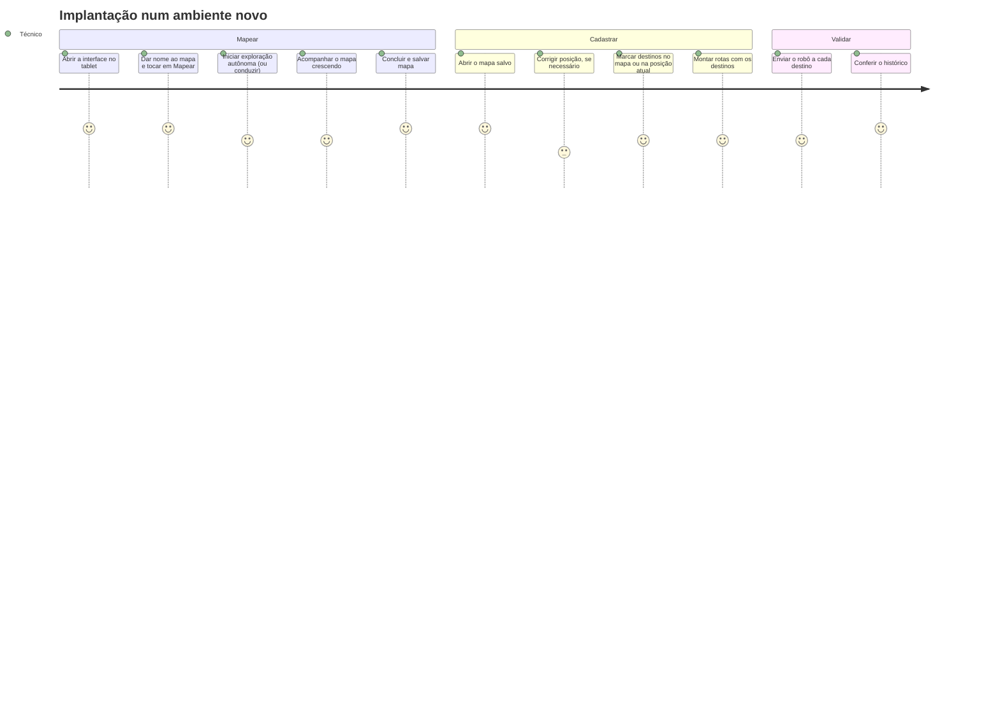
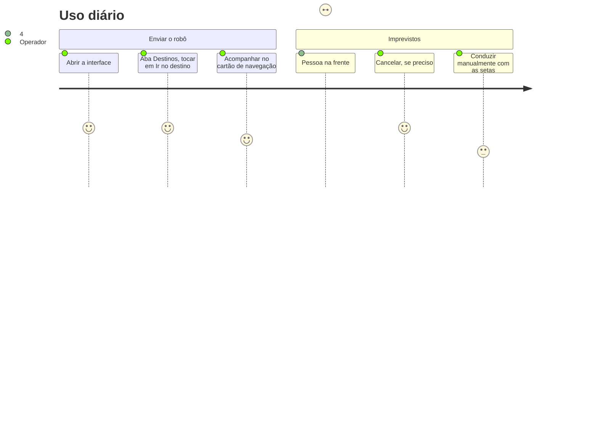
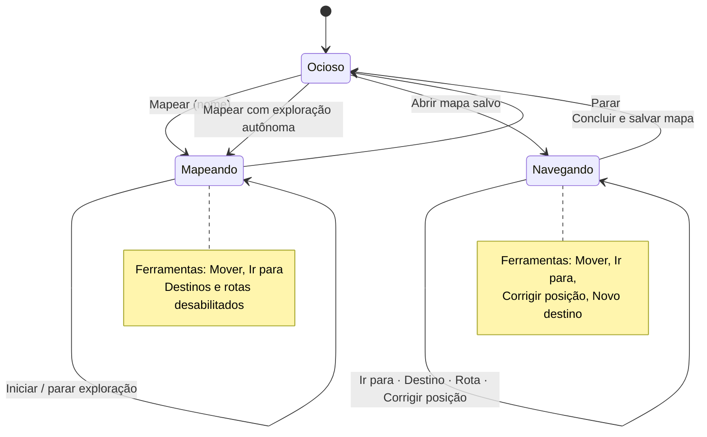

# Experiência do usuário

A interface web é a forma de operar o robô sem conhecer ROS. Ela é
**complementar**: o foco do projeto é controle e navegação, e tudo o que a
interface faz também pode ser feito pela linha de comando ([api.md §7](api.md)).
Mesmo assim, foi projetada para quem vai usar o robô no dia a dia, e não para o
desenvolvedor.

---

## 1. Usuários

| Perfil | Objetivo | O que precisa da interface |
|---|---|---|
| **Operador** (funcionário do estabelecimento) | mandar o robô a um lugar ou fazer uma ronda | destinos com nome, um toque para ir, saber se chegou |
| **Técnico de implantação** | mapear o ambiente e cadastrar destinos e rotas | criar mapa (conduzindo ou com exploração autônoma), corrigir a localização, ver diagnóstico |
| **Pesquisador** | avaliar o desempenho da navegação | histórico com resultado, tempo, distância, recuperações, folga mínima e erro final |

Premissas de projeto:

- **Tablet ou celular** ao lado do robô; por isso os controles são grandes, para
  toque, e o layout se reorganiza em telas estreitas.
- **Sem jargão**: "Ir para", "Corrigir posição", "Concluir e salvar mapa", em
  vez de "goal", "initial pose" ou "SLAM".
- **O estado do robô sempre visível**: conexão, localização, motores, IMU e
  modo da sessão ficam na barra superior.

---

## 2. Jornadas

### 2.1 Técnico: implantar o robô num ambiente novo



O ponto de mais atrito é **corrigir a posição**: ao abrir um mapa, o RTAB-Map
pode levar alguns segundos para reconhecer o lugar. A barra superior mostra
"Sem localização" até lá, e a ferramenta *Corrigir posição* permite ajudar
(toque onde o robô está e arraste na direção dele).

### 2.2 Operador: uso diário



### 2.3 Fluxo de telas



A interface **só mostra o que faz sentido no modo atual**: durante o
mapeamento não há destinos (eles pertencem a um mapa salvo); no modo ocioso, só
a sessão está disponível. Isso evita erros como criar um destino num mapa que
ainda vai mudar.

---

## 3. Layout

```
┌───────────────────────────────────────────────────────────────────────┐
│ Operação do Robô   ● Conectado  ● Localizado  ● Motores  ● IMU  [Sim] │  barra de estado
├──────────────────────────────────────────────┬────────────────────────┤
│ [Mover] [Ir para] [Corrigir posição] [Novo…] │ Operar Destinos Rotas  │  abas
│ Toque no destino. Arraste para a direção.    │ Histórico              │
│ ┌──────────────────────────────────────────┐ │ ┌────────────────────┐ │
│ │                                          │ │ │ Indo para "caixa"  │ │  cartão da
│ │        mapa de ocupação                  │ │ │ 2,4 m restantes    │ │  navegação
│ │        + robô (seta)                     │ │ │ [Cancelar]         │ │
│ │        + caminho planejado               │ │ └────────────────────┘ │
│ │        + pontos do laser                 │ │ Sessão                 │
│ │        + destinos salvos                 │ │  mapa ▾  [Abrir]       │
│ │                              [+][−][⤢]  │ │  nome    [Mapear]      │
│ └──────────────────────────────────────────┘ │ Condução manual        │
│                                              │      ▲                 │
│                                              │    ◀   ▶               │
│                                              │      ▼                 │
└──────────────────────────────────────────────┴────────────────────────┘
                         abaixo de 860 px: barra lateral vai para baixo do mapa
```

### Capturas de tela

| Tela | Arquivo |
|---|---|
| Mapeamento com exploração autônoma | `docs/img/ux-mapeamento.png` |
| Navegação para um destino (caminho e laser visíveis) | `docs/img/ux-navegacao.png` |
| Destinos e rotas | `docs/img/ux-destinos-rotas.png` |
| Histórico | `docs/img/ux-historico.png` |
| Layout no celular | `docs/img/ux-celular.png` |

<!-- Capturar na simulação (scripts/start_sim.sh --people) e salvar em docs/img/. -->

---

## 4. Decisões de interação

| Decisão | Motivo |
|---|---|
| **Tocar e arrastar** para dar destino e direção | um gesto só define posição e orientação final. Um toque sem arrastar usa a orientação 0 (eixo x do mapa) |
| **Ferramenta ativa explícita** (Mover / Ir para / Corrigir / Novo destino) com dica em texto abaixo | o mesmo toque no mapa tem efeitos diferentes; a dica diz o que vai acontecer antes do toque |
| **Condução manual segurando o botão** | o comando é reenviado a 5 Hz enquanto o dedo está no botão; soltar, arrastar para fora ou perder a conexão para o robô (o driver para sozinho em 0,5 s sem comandos). É o princípio do "homem-morto" |
| **Qualquer comando manual encerra a exploração autônoma** | o operador sempre tem prioridade sobre o robô, sem precisar procurar o botão de parar a exploração |
| **Cartão da navegação** sempre visível, acima das abas | mostra para onde o robô vai, quanto falta, qual trecho da rota e o resultado, com botão de cancelar sempre à mão |
| **Mensagens temporárias** (*toasts*) para confirmações e erros | erros ficam 6 s na tela e confirmações 3 s, sem bloquear a operação |
| **Mensagens de erro do backend em linguagem de operador** | "Posição do robô indisponível (ele está localizado?)" em vez de "TransformException" |
| **Decisões da exploração** em lista, durante o mapeamento autônomo | o robô explorando sozinho parece imprevisível ("por que ele virou?"). A lista mostra cada decisão com horário (seguir a parede, ir a uma fronteira, descartar um destino e o motivo, iniciar um passe), a mais recente em destaque. Serve ao técnico para confiar no robô e ao pesquisador para analisar a estratégia |
| **Laser opcional** sobre o mapa | ajuda a ver por que o robô parou (um obstáculo que não está no mapa), mas polui a tela para o uso diário |
| **Parar a sessão de mapeamento = salvar** ("Concluir e salvar mapa") | o RTAB-Map grava o mapa ao encerrar; o rótulo deixa claro que nada se perde |

---

## 5. Acessibilidade

A interface segue as recomendações da **WCAG 2.1** dentro do possível para um
painel de operação de robô:

- **Texto além da cor**: os indicadores da barra de estado têm rótulo
  ("Localizado", "Sem localização", "Motores: ..."), não só um ponto colorido.
- **Região de mensagens** com `role="status"` e lista de decisões da exploração com `role="log"`, anunciadas por leitores de tela.
- **Botões com nome acessível**: os botões de seta da condução manual têm
  `aria-label` ("Frente", "Ré", "Girar à esquerda", "Girar à direita"), e os
  controles de zoom do mapa têm título.
- **Alvos de toque grandes** e layout que se reorganiza em telas estreitas.
- **Dicas em texto** para cada ferramenta do mapa.

**Limitação conhecida:** o mapa é um `canvas` e depende de visão. As
informações essenciais também aparecem em texto (estado da localização,
destino atual, distância restante, resultado e histórico), e destinos e rotas
podem ser usados pelas listas, sem tocar no mapa. Operar um robô móvel exige,
de qualquer forma, acompanhar visualmente o ambiente em que ele se move, por
segurança.
